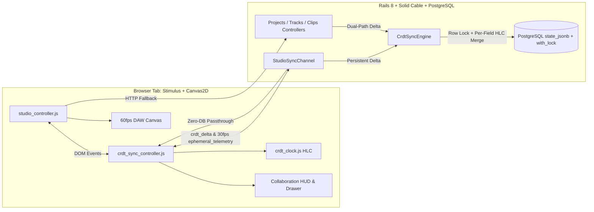

# Requirements

### Overview & Goals
Build a zero-dependency, low-latency **ActionCable + Hybrid Logical Clock (HLC) CRDT Collaborative Sync Engine** for **Jyki** (`Saanskara Studio DAW & 6-Deck DJ Workstation`), connecting the Rails 8 + Solid Cable + PostgreSQL backend with the Stimulus + HTML5 `<canvas>` frontend.

The engine enables multiple concurrent collaborators (authenticated users or multi-tab local guests) to simultaneously edit project parameters, mixer faders, tracks, and timeline clips with **per-field Last-Write-Wins (LWW-Element-Map) conflict resolution**, zero `ActiveRecord::StaleObjectError` crashes, 30fps zero-DB-write ephemeral cursor/fader telemetry, offline delta queuing, branch snapshots (`CrdtBranch`), and live studio chat (`StudioChatMessage` + `ProjectCollaborator`).

---

### Scope

#### In Scope
1. **HLC & LWW-Element-Map CRDT Resolver (`CrdtSyncEngine` & `crdt_clock.js`):**
   - Deterministic HLC timestamp generation, parsing, and lexicographical comparison (`"<wall_ms>-<logical_counter>-<node_id>"`).
   - Per-field watermark storage in `state_jsonb["hlc"]` across `Project`, `Track`, `TrackClip`, `MidiClip`, and `AutomationLane`.
   - Row-level locking (`record.with_lock`) during delta application so concurrent edits to different fields on the same record merge losslessly without `ActiveRecord::StaleObjectError`.
   - Automatic `CrdtBranch#delta_vector` and `committed_at_label` progression upon committed deltas.
2. **ActionCable Real-Time Channel (`ApplicationCable::Connection` & `StudioSyncChannel`):**
   - Session identity resolution for Devise users and deterministic multi-tab guest collaborators (`node_id`, `username`, `role`, `color_hex`).
   - Project stream (`"studio_project_#{project.uuid}"`) supporting `presence_join`/`presence_leave`, `crdt_delta`, `ephemeral_telemetry` (zero DB writes), `chat_message`, `add_collaborator`, and `switch_or_snapshot_branch`.
   - Dual-path persistence: existing REST endpoints (`ProjectsController`, `TracksController`, `TrackClipsController`) also apply updates through `CrdtSyncEngine` and broadcast `crdt_delta_ack`.
3. **Frontend CRDT Client & Collaborative Canvas (`crdt_sync_controller.js` & `studio_controller.js`):**
   - Client-side `HybridLogicalClock` and LWW register comparison in `app/javascript/lib/crdt_clock.js` pinned in `config/importmap.rb`.
   - Dedicated `crdt_sync_controller.js` handling ActionCable WebSocket lifecycle, `pendingDeltas` offline queue & reconnect flush, 30fps throttled `ephemeral_telemetry`, and DOM event coordination with `studio_controller.js`.
   - Multi-user ghost cursors (colored flag + username + tick position) and ghost clip drag previews rendered at 60fps on the DAW `<canvas>`.
4. **Collaboration HUD & Drawer (`app/views/home/index.html.erb`):**
   - Top transport bar CRDT & Collaborator Presence Strip (connection badge, `CrdtBranch` selector & snapshot button, live collaborator avatars).
   - Collapsible right/bottom drawer with Tab 1 (Live CRDT Vector Feed) and Tab 2 (Studio Chat & Collaborators roster).
5. **Seeding & Verification:**
   - Default `CrdtBranch`, `ProjectCollaborator`, and `StudioChatMessage` records seeded via `db/seeds.rb` and `StudioBootstrapper.ensure_default_project!`.
   - Automated Minitest coverage for out-of-order concurrent HLC field merges, stale HLC rejection, channel RPCs, and UI rendering.

#### Out of Scope
- External NPM/Node CRDT libraries (`yjs`, `automerge`) or Redis dependencies (uses Rails 8 Solid Cable and native ES6 modules via Importmap).
- Raw PCM audio stream transmission over ActionCable (WebSocket handles CRDT control deltas, MIDI/clip metadata, chat, and ephemeral cursor/fader telemetry).

---

### User Stories
- **As a studio producer collaborating with a mastering engineer**, I want simultaneous edits to different controls on the same track (e.g., adjusting `Track 1 Volume` while my peer adjusts `Track 1 Pan` or drags a `TrackClip`) to merge automatically without overwriting each other or raising lock errors.
- **As a live collaborator**, I want to see remote peers' timeline cursors, clip drag ghosts, and fader movements in real time on the DAW `<canvas>` without causing database write amplification during continuous pointer drags.
- **As a session owner**, I want to view the live HLC operation log, snapshot/switch `CrdtBranch` vectors, manage `ProjectCollaborator` roles, and chat with studio participants directly inside the studio HUD.
- **As a producer on an unstable network**, I want local edits made while disconnected to queue in memory and flush in strict HLC order as soon as the WebSocket reconnects.

---

### Functional Requirements
1. **HLC Ordering & LWW-Element-Map Resolution:**
   - HLC strings must be formatted as `"<13_digit_wall_ms>-<4_digit_hex_or_dec_counter>-<node_id>"` (e.g., `"1762809123450-0001-node_a8f2"`) so standard lexicographical comparison (`incoming_hlc > existing_hlc`) defines a strict total order.
   - For each field in `changes`, `CrdtSyncEngine.apply_delta!` compares `incoming_hlc` against `record.state_jsonb.dig("hlc", field)` and applies only fields with strictly newer HLCs.
   - Deleted entities (`action: "delete"`) mark or destroy the target record while recording a tombstone watermark in the project/branch state so out-of-order stale updates cannot resurrect deleted entities.
2. **Zero-DB-Write Ephemeral Telemetry:**
   - Pointer movement over the timeline canvas, active clip dragging, playhead scrubbing, and continuous volume/pan slider dragging emit `ephemeral_telemetry` throttled to ~30fps (`33ms`) and broadcast directly to peers without touching PostgreSQL.
   - Releasing a drag or committing a control change emits `crdt_delta` to persist the final state to PostgreSQL.
3. **Offline Queue & Reconnect Flush:**
   - When the `StudioSyncChannel` subscription is disconnected, outbound `crdt_delta` operations append to `this.pendingDeltas`.
   - Upon `connected()`, `crdt_sync_controller.js` sorts `pendingDeltas` by `hlc` ascending and transmits each operation sequentially.

---

### Non-Functional Requirements
- **Zero External Dependencies:** Pure Ruby service + vanilla ES6 modules pinned via `config/importmap.rb`.
- **Sub-5ms Broadcast Overhead:** Ephemeral telemetry bypasses ActiveRecord completely; persistent deltas acquire a lightweight row lock on the target entity and broadcast a compact JSON ack.
- **Theme Token Compliance:** All new HUD badges, presence avatars, ghost cursors, and drawer tabs must use `--saanskara-*` CSS custom properties and compile cleanly via `bin/css-pipeline`.

# Technical Design

### Current Implementation
- **Database Schema (`db/schema.rb`):**
  - Core models (`projects`, `tracks`, `track_clips`, `midi_clips`, `audio_samples`, `automation_lanes`) already include `uuid` (`uuid`, unique index), `state_jsonb` (`jsonb`, default `{}`), and `lock_version` (`integer`, default `0`).
  - Collaboration tables `crdt_branches` (`name`, `delta_vector`, `committed_at_label`), `project_collaborators` (`project_slug`, `username`, `external_user_id`, `email`, `role`, `added_at_label`), `studio_chat_messages` (`sender_name`, `sender_role`, `body`, `room_type`, `recipient_handle`, `sent_at_label`), and `solid_cable_messages` are migrated and backed by `CrdtBranch`, `ProjectCollaborator`, and `StudioChatMessage` models.
- **Backend Controllers & Services:**
  - `StudioBootstrapper` (`app/services/studio_bootstrapper.rb`) seeds `"Saanskara Raga Session 01"` and serializes `@studio_payload_json` for `HomeController#index` (`app/views/home/index.html.erb`).
  - `ProjectsController`, `TracksController`, and `TrackClipsController` currently perform direct ActiveRecord `.update` / `.create` / `.destroy!` calls without updating `state_jsonb["hlc"]` or broadcasting over ActionCable.
  - No `app/channels/` files exist yet, and `@rails/actioncable` is not yet pinned in `config/importmap.rb`.
- **Frontend Stimulus (`app/javascript/controllers/studio_controller.js`):**
  - Manages the 60fps `<canvas>` timeline, 6-deck DJ view, WebAudio synth preview, and REST `fetch` persistence, but has no HLC clock, ActionCable subscription, remote delta merging, or ghost cursor rendering.

---

### Key Decisions
1. **Dedicated Sync Controller (`crdt_sync_controller.js` + `crdt_clock.js`):**
   - Isolate WebSocket lifecycle, HLC clock state, peer presence roster, offline `pendingDeltas` queue, live CRDT vector log, and studio chat in `app/javascript/controllers/crdt_sync_controller.js` + `app/javascript/lib/crdt_clock.js`.
   - Communicate state deltas (`crdt:local-change`, `crdt:remote-delta`) and ephemeral telemetry (`crdt:local-telemetry`, `crdt:remote-telemetry`) with `studio_controller.js` via custom DOM events on `#saanskara-daw`.
2. **Dual-Path Mutation Transport (ActionCable RPC + REST Fallback):**
   - Live client mutations transmit over `StudioSyncChannel#crdt_delta` for immediate peer fan-out, while also upgrading `ProjectsController`, `TracksController`, and `TrackClipsController` to delegate mutations through `CrdtSyncEngine.apply_delta!` so HTTP fallback requests and controller integration tests maintain identical HLC watermarks.
3. **Row-Level Pessimistic Locking (`record.with_lock`) in `CrdtSyncEngine`:**
   - Because all core tables include `lock_version` (enabling ActiveRecord optimistic locking), `CrdtSyncEngine.apply_delta!` acquires a row-level `with_lock` (`SELECT ... FOR UPDATE`) before comparing `state_jsonb["hlc"]` per field and saving. This serializes concurrent field updates on the same record cleanly with zero `ActiveRecord::StaleObjectError` exceptions.

---

### Proposed Changes

#### 1. Backend CRDT Engine (`app/services/crdt_sync_engine.rb`)
- Implement `CrdtSyncEngine` with:
  - **HLC Utilities:**
    - `generate_hlc(last_hlc: nil, node_id: "server", now_ms: (Time.current.to_f * 1000).to_i)` returning `"%013d-%04d-%s"` (`<wall_ms>-<logical_counter>-<node_id>`).
    - `parse_hlc(hlc_string)` and `compare_hlc(hlc_a, hlc_b)` performing deterministic comparison by `(wall_ms, counter, node_id)` and lexicographical string ordering.
  - **Allowed Mutable Fields Registry:**
    - `Project`: `name`, `bpm`, `time_signature_numerator`, `time_signature_denominator`, `root_note`, `scale_name`, `master_volume_db`, `swing_amount`, `workspace_mode`, `theme_name`, `settings_jsonb`.
    - `Track`: `name`, `track_type`, `deck_number`, `position`, `color_hex`, `volume_db`, `pan`, `muted`, `soloed`, `armed`, `fx_chain_jsonb`, `input_routing_jsonb`.
    - `TrackClip`: `track_id`, `clip_kind`, `name`, `color_hex`, `start_tick`, `duration_ticks`, `source_offset_ticks`, `loop_enabled`, `loop_start_tick`, `loop_end_tick`, `gain_db`, `transpose_semitones`, `detune_cents`, `warp_enabled`, `warp_algorithm`, `time_stretch_ratio`, `fade_in_ticks`, `fade_out_ticks`, `fade_curve`, `muted`.
    - `MidiClip`: `name`, `length_ticks`, `note_count`, `events_jsonb`, `groove_template_jsonb`.
    - `AutomationLane`: `parameter_path`, `min_value`, `max_value`, `points_jsonb`, `bypassed`.
  - **`apply_delta!(project, delta_payload)`:**
    - Supports `action: "update" | "create" | "delete"` across `entity_type` (`"Project"`, `"Track"`, `"TrackClip"`, `"MidiClip"`, `"AutomationLane"`).
    - For `"update"`, locates the record within `project` by `uuid` (or `id` fallback), enters `record.with_lock`, inspects `state_jsonb["hlc"] || {}`, and applies each `(field, value)` in `changes` **only if** `compare_hlc(incoming_hlc, existing_hlc_map[field]) > 0`.
    - Updates `state_jsonb["hlc"][field] = incoming_hlc`, `state_jsonb["last_actor"] = actor`, and `state_jsonb["tombstone"] = false`.
    - For `"create"`, idempotently finds or initializes the record by `uuid` under `project`, assigns default source (`AudioSample` / `MidiClip`) when creating a `TrackClip`, initializes per-field HLC watermarks in `state_jsonb["hlc"]`, and persists.
    - For `"delete"`, marks `tombstone: true` and destroys the target `Track` or `TrackClip` while recording the deletion watermark in `project.state_jsonb["tombstones"][entity_uuid] = incoming_hlc` so late-arriving updates with older HLCs are ignored.
    - Updates `project.crdt_branch` (creating or linking `"main"` if nil) with a new `delta_vector` summary and `committed_at_label`.

#### 2. ActionCable Connection & Channel (`app/channels/`)
- **`ApplicationCable::Connection` (`app/channels/application_cable/connection.rb`):**
  - `identified_by :current_user, :collaborator_profile`
  - Resolves `env["warden"]&.user` if signed in, or builds a deterministic guest profile from `request.params[:client_node_id]` / cookies (`node_id`, `username`, `display_name`, `role`, `color_hex`) so opening multiple browser tabs immediately creates distinct live collaborators.
- **`StudioSyncChannel` (`app/channels/studio_sync_channel.rb`):**
  - Streams from `"studio_project_#{@project.uuid}"`.
  - On `subscribed`: broadcasts `type: "presence_join"` with collaborator metadata and current `crdt_branch` summary.
  - On `unsubscribed`: broadcasts `type: "presence_leave"`.
  - `crdt_delta(data)`: calls `CrdtSyncEngine.apply_delta!(@project, data)` and broadcasts `type: "crdt_delta_ack"` (including `op_id`, `origin_node_id`, `entity_type`, `entity_uuid`, `action`, `applied_changes`, `rejected_fields`, `hlc`, `actor`, `serialized_entity`, and `branch` metadata) to `"studio_project_#{@project.uuid}"`.
  - `ephemeral_telemetry(data)`: immediately broadcasts `type: "ephemeral_telemetry"` (cursor tick, cursor track UUID, dragging clip UUID + preview start/duration ticks, live fader volume/pan, transport state) to `"studio_project_#{@project.uuid}"` with zero database queries.
  - `chat_message(data)`: creates a `StudioChatMessage` and broadcasts `type: "chat_message"`.
  - `add_collaborator(data)`: creates or updates a `ProjectCollaborator` for `@project.slug || "proj_default"` and broadcasts `type: "collaborator_added"`.
  - `switch_or_snapshot_branch(data)`: creates or switches `@project.crdt_branch` and broadcasts `type: "branch_switched"`.

#### 3. Frontend HLC Clock, CRDT Controller & Canvas Ghost Rendering (`app/javascript/`)
- **`app/javascript/lib/crdt_clock.js`:**
  - Exports `HybridLogicalClock` class with `now()`, `receive(remoteHlcString)`, ` static parse(hlc)`, `static compare(a, b)`, and `shouldApply(localHlcMap, field, incomingHlc)`.
- **`app/javascript/controllers/crdt_sync_controller.js`:**
  - Instantiates `HybridLogicalClock` with a unique per-tab `node_id` (stored in `sessionStorage` so two tabs in the same browser get two distinct `node_id`s and colors).
  - Subscribes to `StudioSyncChannel` (`{ channel: "StudioSyncChannel", project_uuid: ..., client_node_id: ... }`).
  - Listens for `crdt:local-change` and `crdt:local-telemetry` events from `studio_controller.js`.
  - Maintains `this.pendingDeltas = []` when offline and flushes in HLC order on `connected()`.
  - Appends formatted entries (`[1762809-0001-node_4f] Track 01 volume_db -> -1.5dB`) to the Live CRDT Vector Feed target.
- **`app/javascript/controllers/studio_controller.js`:**
  - Stores `this.remotePeers = new Map()` (keyed by `node_id`) updated from `crdt:remote-telemetry` and `presence_join`/`presence_leave`.
  - Renders remote collaborators' live timeline cursors (vertical colored indicator + glowing top flag with `username` and `Bar.Beat` readout) and translucent ghost clip boxes when a peer is actively dragging/resizing a clip.
  - Applies inbound `crdt:remote-delta` events using `HybridLogicalClock.shouldApply`, updating `this.project`, track header DOM controls (mute/solo/arm buttons, volume/pan sliders, BPM/scale/theme inputs), and redrawing the `<canvas>`.

---

### Data Models / Contracts

#### HLC Watermark Structure in `state_jsonb`
```json
{
  "hlc": {
    "volume_db": "1762809123450-0001-node_a8f2",
    "pan": "1762809123100-0000-node_b3c9",
    "muted": "1762809120000-0002-node_a8f2"
  },
  "tombstone": false,
  "last_actor": "aria_mastering"
}
```

#### `CrdtSyncEngine` Contract
```ruby
CrdtSyncEngine.apply_delta!(
  project,
  {
    op_id: "op_9f8a12",
    origin_node_id: "node_a8f2",
    actor: "aria_mastering",
    entity_type: "Track", # "Project" | "Track" | "TrackClip" | "MidiClip" | "AutomationLane"
    entity_uuid: track.uuid,
    action: "update",     # "update" | "create" | "delete"
    changes: { "volume_db" => -2.5, "pan" => 0.25 },
    hlc: "1762809123450-0001-node_a8f2",
    branch_name: "main (master-bus-locked)"
  }
)

# => {

# ok: true,

# applied: true,

# op_id: "op_9f8a12",

# origin_node_id: "node_a8f2",

# actor: "aria_mastering",

# entity_type: "Track",

# entity_uuid: "...",

# action: "update",

# applied_changes: { "volume_db" => -2.5, "pan" => 0.25 },

# rejected_fields: [],

# hlc: "1762809123450-0001-node_a8f2",

# state_jsonb: { "hlc" => { ... }, "tombstone" => false, "last_actor" => "aria_mastering" },

# serialized_entity: { ... },

# branch: { id: 1, name: "main (master-bus-locked)", delta_vector: "...", committed_at_label: "..." }

# }

```

---

### File Structure
```text
app/
├── channels/
│   ├── application_cable/
│   │   ├── channel.rb                      (Added)
│   │   └── connection.rb                   (Added)
│   └── studio_sync_channel.rb              (Added)
├── controllers/
│   ├── home_controller.rb                  (Modified: load branches, collaborators, chat messages)
│   ├── projects_controller.rb              (Modified: delegate update to CrdtSyncEngine + broadcast)
│   ├── tracks_controller.rb                (Modified: delegate create/update/destroy to CrdtSyncEngine + broadcast)
│   └── track_clips_controller.rb           (Modified: delegate create/update/destroy to CrdtSyncEngine + broadcast)
├── javascript/
│   ├── controllers/
│   │   ├── crdt_sync_controller.js         (Added: ActionCable client, HLC queue, vector feed, chat/branch UI)
│   │   └── studio_controller.js            (Modified: emit deltas/telemetry, apply remote deltas, draw ghost cursors)
│   └── lib/
│       └── crdt_clock.js                   (Added: HybridLogicalClock & LWW register helpers)
├── services/
│   ├── crdt_sync_engine.rb                 (Added: HLC parser/comparator & row-locked LWW-Element-Map resolver)
│   └── studio_bootstrapper.rb              (Modified: ensure default branches/collaborators/messages & serialize HLC state)
├── views/
│   └── home/
│       └── index.html.erb                  (Modified: Top CRDT Presence Strip + Collapsible Chat & Vector Log Drawer)
└── assets/
    └── scss/
        └── components/
            ├── _daw_canvas.scss            (Modified: collaboration drawer & vector feed styles)
            └── _transport_bar.scss         (Modified: presence avatars & CRDT status badge styles)
config/
└── importmap.rb                            (Modified: pin @rails/actioncable and lib/crdt_clock)
test/
├── channels/
│   └── studio_sync_channel_test.rb         (Added: ActionCable subscription, crdt_delta, telemetry, chat, branch tests)
├── services/
│   └── crdt_sync_engine_test.rb            (Added: concurrent out-of-order HLC merge & stale rejection unit tests)
└── controllers/
    └── home_controller_test.rb             (Modified: verify collaboration HUD, Dual-Path REST HLC updates)
```

---

### Architecture Diagram


---

### Risks & Mitigations
- **ActiveRecord Optimistic Locking Collisions (`lock_version`):**
  - *Risk:* Concurrent updates to a `Track` or `TrackClip` with `lock_version` can raise `ActiveRecord::StaleObjectError` if loaded outside a lock.
  - *Mitigation:* `CrdtSyncEngine.apply_delta!` wraps field resolution inside `record.with_lock` (`SELECT ... FOR UPDATE`), ensuring fresh `lock_version` and `state_jsonb` state on every write.
- **Echo Jitter on Local Dragging:**
  - *Risk:* Broadcasting `crdt_delta_ack` back to the originating tab while the user is still dragging a fader or clip can cause visual jitter.
  - *Mitigation:* Include `origin_node_id` and `op_id` in every delta ack; `crdt_sync_controller.js` marks locally originated `op_id`s as acknowledged in the vector log without overwriting an active local drag in `studio_controller.js`.
- **Database Write Amplification on Fader/Cursor Movement:**
  - *Risk:* Writing 60fps mouse/fader movements to PostgreSQL would saturate DB connections.
  - *Mitigation:* Continuous drags emit `ephemeral_telemetry` throttled to 30fps (`33ms`) which `StudioSyncChannel` rebroadcasts directly in memory without touching ActiveRecord; only the final commit emits `crdt_delta`.

# Testing

### Validation Approach
All components will be validated through fast Minitest unit, channel, and integration tests (`CI= bin/rails test`), one-off CSS compilation (`bin/css-pipeline`), and lint/security checks (`bin/rubocop` on touched files and `bin/brakeman --no-pager --skip-files research/`). Never run blocking servers (`bin/dev` or `bin/rails server`).

---

### Key Scenarios
1. **Concurrent Out-of-Order HLC Field Merges (`CrdtSyncEngineTest`):**
   - User A updates `Track#volume_db` (`hlc: "1762809123450-0001-node_a"`) and User B updates `Track#pan` (`hlc: "1762809123100-0000-node_b"`).
   - Even when User B's older HLC arrives after User A's newer HLC, both `volume_db` and `pan` changes are preserved in PostgreSQL and `state_jsonb["hlc"]` records each field's independent watermark.
   - Simultaneous edits to `TrackClip#start_tick` and `TrackClip#gain_db` merge with zero data loss and zero `ActiveRecord::StaleObjectError` exceptions.
2. **Stale HLC Rejection (`CrdtSyncEngineTest`):**
   - When a delta arrives for `Track#volume_db` with an HLC lexicographically older than `track.state_jsonb.dig("hlc", "volume_db")`, `CrdtSyncEngine` rejects the stale field mutation while still applying any other field in the same payload that has a newer HLC.
3. **ActionCable Real-Time Broadcasts (`StudioSyncChannelTest`):**
   - Subscribing to `StudioSyncChannel` streams from `"studio_project_#{project.uuid}"` and broadcasts a `presence_join` packet.
   - Performing `crdt_delta` persists the mutation via `CrdtSyncEngine`, updates the `CrdtBranch#delta_vector`, and broadcasts `crdt_delta_ack`.
   - Performing `ephemeral_telemetry` broadcasts cursor/fader/transport telemetry to `"studio_project_#{project.uuid}"` with 0 SQL `INSERT`/`UPDATE` queries.
   - Performing `chat_message` and `switch_or_snapshot_branch` persists `StudioChatMessage` / `CrdtBranch` records and broadcasts updates to peers.
4. **Collaboration HUD & Dual-Path REST Integration (`HomeControllerTest`):**
   - `GET /home` renders the CRDT Presence Strip (`data-controller*="crdt-sync"`), active `CrdtBranch` badge, collaborator avatars, and the collapsible CRDT Vector Feed + Studio Chat drawer.
   - `PATCH /projects/:id`, `PATCH /tracks/:id`, and `PATCH /track_clips/:id` update `state_jsonb["hlc"]` watermarks via `CrdtSyncEngine`.

---

### Edge Cases
- **Clock Drift Across Clients:** If a client's wall clock is behind the server or another peer's HLC wall time, `HybridLogicalClock.receive(remoteHlc)` advances the local logical counter above the highest observed `wall_ms` so subsequent local edits always sort after previously observed remote state.
- **Delete vs. Late Update Race (Tombstones):** Deleting a `TrackClip` records its UUID and deletion HLC in `project.state_jsonb["tombstones"]`; any delayed update for that UUID with an older HLC is cleanly ignored instead of raising `ActiveRecord::RecordNotFound`.
- **Guest Multi-Tab Collisions:** Two unauthenticated tabs sharing the same browser cookies generate distinct `client_node_id` values via `sessionStorage` and receive distinct collaborator handles and cursor colors.

---

### Test Changes
- Add `test/services/crdt_sync_engine_test.rb` testing HLC parsing/comparison, concurrent multi-field merges on `Project`, `Track`, and `TrackClip`, stale field rejection, tombstone handling, and `CrdtBranch` delta vector updates.
- Add `test/channels/studio_sync_channel_test.rb` testing `ApplicationCable::Connection` guest/user identification and `StudioSyncChannel` actions (`crdt_delta`, `ephemeral_telemetry`, `chat_message`, `add_collaborator`, `switch_or_snapshot_branch`).
- Update `test/controllers/home_controller_test.rb` to assert the new CRDT collaboration HUD elements, seeded branches/collaborators/chat messages, and `state_jsonb["hlc"]` persistence on REST updates.

# Delivery Steps

### ✓ Step 1: Build CrdtSyncEngine & Seed Collaboration State
`CrdtSyncEngine` deterministically merges per-field HLC deltas under row-level locks without `ActiveRecord::StaleObjectError`, and `StudioBootstrapper` / `db/seeds.rb` populate default `CrdtBranch`, `ProjectCollaborator`, and `StudioChatMessage` records.

- Create `app/services/crdt_sync_engine.rb` implementing HLC generation/parsing (`"<wall_ms>-<logical_counter>-<node_id>"`), lexicographical comparison (`compare_hlc`), and `apply_delta!(project, payload)` supporting `Project`, `Track`, `TrackClip`, `MidiClip`, and `AutomationLane`.
- Use `record.with_lock` inside `CrdtSyncEngine.apply_delta!` to serialize concurrent field updates on the same row, merge only fields where `incoming_hlc > state_jsonb.dig("hlc", field)`, record `last_actor` and `tombstone` metadata in `state_jsonb`, and update the linked `CrdtBranch` (`delta_vector` and `committed_at_label`).
- Update `StudioBootstrapper` (`app/services/studio_bootstrapper.rb`) and `db/seeds.rb` so `ensure_default_project!` seeds default `CrdtBranch`, `ProjectCollaborator`, and `StudioChatMessage` records, links the default project to the primary `CrdtBranch`, and includes `state_jsonb`, `crdt_branch`, `branches`, `collaborators`, and `chat_messages` in `serialize_project`.
- Add unit tests in `test/models/daw_domain_test.rb` (or `test/services/crdt_sync_engine_test.rb`) verifying out-of-order concurrent HLC edits to distinct fields on the same `Track` and `TrackClip` merge losslessly and stale HLC timestamps are rejected.

### ✓ Step 2: Implement ActionCable StudioSyncChannel & Dual-Path REST Sync
`ApplicationCable::Connection` identifies authenticated or guest collaborators, `StudioSyncChannel` handles real-time CRDT deltas, 30fps ephemeral telemetry, chat, and branch snapshots, and REST controllers route updates through `CrdtSyncEngine`.

- Create `app/channels/application_cable/connection.rb` and `app/channels/application_cable/channel.rb` identifying `current_user` (from Devise/Warden) or generating a deterministic guest collaborator profile (`node_id`, `username`, `display_name`, `role`, `color_hex`).
- Implement `app/channels/studio_sync_channel.rb` streaming from `"studio_project_#{@project.uuid}"` with `subscribed`/`unsubscribed` presence broadcasts and RPC actions: `crdt_delta`, `ephemeral_telemetry` (zero-DB-write cursor/playhead/fader broadcast), `chat_message` (persisting `StudioChatMessage`), `add_collaborator` (persisting `ProjectCollaborator`), and `switch_or_snapshot_branch` (creating/switching `CrdtBranch`).
- Upgrade `ProjectsController#update`, `TracksController#create/update/destroy`, and `TrackClipsController#create/update/destroy` to route mutations through `CrdtSyncEngine.apply_delta!` and broadcast `crdt_delta_ack` to `"studio_project_#{project.uuid}"` for Dual-Path sync compatibility.
- Add ActionCable channel and controller integration tests verifying subscription presence, `crdt_delta` persistence and peer broadcast, `ephemeral_telemetry` zero-DB passthrough, chat persistence, and branch switching.

### ✓ Step 3: Build Client HLC Clock, CRDT Sync Controller & Ghost Canvas Renderer
`crdt_clock.js` and `crdt_sync_controller.js` manage client HLC watermarks, ActionCable RPCs, offline delta queuing, and ghost cursor/clip drag previews on the `<canvas>` in `studio_controller.js`.

- Pin `@rails/actioncable` (`actioncable.esm.js`) and `lib/crdt_clock` in `config/importmap.rb`, and create `app/javascript/lib/crdt_clock.js` implementing `HybridLogicalClock` (`now()`, `receive()`, `compare()`, `shouldApplyField()`).
- Create `app/javascript/controllers/crdt_sync_controller.js` managing the `StudioSyncChannel` subscription, active peer roster, 30fps throttled `ephemeral_telemetry` emission, outbound `crdt_delta` dispatch with `pendingDeltas` offline queue flush on reconnect, live CRDT vector operation feed, studio chat submission, and branch snapshot/checkout actions.
- Update `app/javascript/controllers/studio_controller.js` to emit local mutations and pointer/fader telemetry events to `crdt_sync_controller.js`, apply inbound remote `crdt_delta_ack` payloads when `remote_hlc > local_hlc`, and render remote collaborator ghost cursors (colored flag + username + tick) and ghost clip drag previews on the DAW `<canvas>`.

### * Step 4: Add Collaboration HUD, Live Vector Feed & Studio Chat Drawer
`app/views/home/index.html.erb` renders the Top Transport CRDT & Collaborator Presence Strip and the collapsible Studio Chat & CRDT Operation Log drawer styled with `--saanskara-*` tokens.

- Update `HomeController#index` and `app/views/home/index.html.erb` to attach `crdt-sync` Stimulus controller attributes and render the Top Transport CRDT Presence Strip: live connection badge (`"⚡ CRDT Sync • Online"`), active `CrdtBranch` selector and snapshot/fork trigger (`"main • v..."`), and live collaborator avatar pills (`project_collaborators` + active WebSocket peers).
- Add the collapsible Collaboration & Telemetry Drawer in `app/views/home/index.html.erb` with Tab 1 (Live CRDT Vector Feed showing real-time incoming/outgoing HLC delta operations) and Tab 2 (Studio Chat `studio_chat_messages` + `project_collaborators` roster and add-collaborator form).
- Add collaboration HUD and drawer styles in `app/assets/scss/components/_daw_canvas.scss` and `app/assets/scss/components/_transport_bar.scss` using `--saanskara-*` theme tokens, compile via `bin/css-pipeline`, and run the full test and lint suite (`CI= bin/rails test`, `bin/rubocop`, `bin/brakeman --no-pager --skip-files research/`).