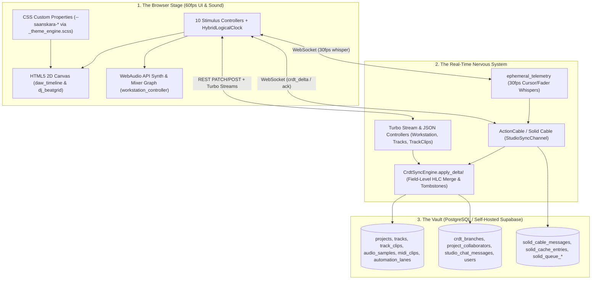

# Requirements

### Overview & Goals
Generate a comprehensive, founder-friendly architectural guide saved to `debrief.md` in the project root directory of **Jyki** (Saanskara Studios). The guide translates Digital Audio Workstation (DAW) engineering and Distributed Systems concepts into intuitive studio analogies while mapping every feature to the exact files, tables, classes, and methods in the repository.

### Scope
#### In Scope
- Writing `debrief.md` in the project root (`/Users/macproadmin/Desktop/Saanskara/code/Jyki/debrief.md`) structured into the 9 required sections.
- Explaining every DAW and distributed systems concept using plain-English musical/studio analogies, business/performance rationale, and exact repository file/method pointers.
- Including rich Markdown tables, callout blocks, and ASCII/Mermaid diagrams (3-Layer Architecture, Database Entity-Relationship diagram, CRDT Dual-Speed Sync sequence diagram, and UI-to-DB lifecycle flows).
- Covering the actual implemented codebase across `db/schema.rb`, `config/routes.rb`, `app/models/`, `app/controllers/`, `app/services/`, `app/channels/`, `app/javascript/`, `app/views/`, `app/assets/scss/`, `ext/`, `research/dsp/`, `bin/`, `config/initializers/saanskara_telemetry.rb`, `config/database.yml`, `config/deploy.yml`, and `Dockerfile`.

#### Out of Scope
- Modifying any existing application code, database migrations, styles, or tests.
- Running blocking server processes (`bin/dev` or `bin/rails server`).

### User Stories
- **As the Founder of Saanskara Studios**, I want a clear translation of DAW concepts (`PPQN`, `Sample Frames`, `TrackClip` vs. `AudioSample`, `Automation Lanes`, `Beatgrids`, `Waveform Peaks`) into everyday studio metaphors so I can understand and communicate why Jyki is fast, memory-light, and non-destructive.
- **As the Founder**, I want to understand how multiple artists across the world (e.g., Ottawa and Mumbai) can jam and edit the same project simultaneously without overwriting each other's work via Hybrid Logical Clocks (`HLC`) and ActionCable (`Solid Cable`).
- **As the Founder**, I want a file-by-file map and a "Where Do I Go To Change X?" playbook so I know exactly which files to inspect or point an engineer/AI agent to when adding themes, shortcuts, default tracks, or DSP effects.

### Functional Requirements
1. **Section 1 — Executive Summary (The 30,000-Foot View):**
   - Explain Jyki's dual identity (**Multi-Track DAW** + **6-Deck Live DJ Workstation**) running at 60fps on Rails 8.1.4 + Hotwire + HTML5 `<canvas>` + WebAudio API without React/Next.js bloat.
   - Include a 3-Layer architecture diagram (Browser Stage, Real-Time Nervous System, The Vault).
2. **Section 2 — "DAW Concepts Translated for Founders" Glossary:**
   - Reference table and deep-dive explanations with studio analogies, business value, and exact code locations for:
     - **PPQN (`960` Pulses Per Quarter Note / `start_tick` & `duration_ticks`)**
     - **Sample Rate (`48,000 Hz`) & Frames (`total_frames`, `source_start_frame`)**
     - **Master Blueprint vs. Timeline Placement (`AudioSample` / `MidiClip` vs. `TrackClip`)**
     - **Tracks, Buses & 6 DJ Decks (`tracks` table with `track_type` & `deck_number: 1..6`)**
     - **Automation Lanes (`automation_lanes` with `parameter_path`, `points_jsonb`, `points_binary`)**
     - **Waveform Peaks (`waveform_peaks_binary` packed 16-bit signed integers `s<*`)**
3. **Section 3 — Guided Tour of the Database (`db/schema.rb` & `app/models/`):**
   - Detailed walkthrough of all 10 domain tables (`projects`, `tracks`, `audio_samples`, `midi_clips`, `track_clips`, `automation_lanes`, `crdt_branches`, `project_collaborators`, `studio_chat_messages`, `users`) plus the PostgreSQL-backed Solid Trifecta tables (`solid_cable_messages`, `solid_cache_entries`, `solid_queue_*`).
   - Entity-Relationship diagram showing ownership, foreign keys (`on_delete: :restrict` on `audio_samples` vs. `:cascade`), and CRDT branch versioning.
4. **Section 4 — Real-Time Multi-User Collaboration (CRDTs + ActionCable):**
   - Explain the Ottawa-vs.-Mumbai concurrent edit problem and how Field-Level Last-Write-Wins Element-Set CRDTs (`state_jsonb["hlc"]`), Hybrid Logical Clocks (`<13-digit-wall-ms>-<4-hex-counter>-<node_id>`), and Tombstones (`state_jsonb["tombstones"]`) solve it.
   - Contrast **Two-Speed Networking**: 30fps `ephemeral_telemetry` whispers (zero DB writes) vs. persistent `crdt_delta` commits (`CrdtSyncEngine.apply_delta!` + `StudioSyncChannel`).
5. **Section 5 — Frontend Architecture: Canvas, WebAudio & Stimulus:**
   - Explain how `app/views/workstation/index.html.erb` (the primary SPA shell at `root "workstation#index"`) and `app/views/home/index.html.erb` (legacy `/home` & `/studio` shell) coordinate with the 10 Stimulus controllers.
   - Trace 4 complete user action lifecycles from mouse click/key press to `<canvas>`/WebAudio, ActionCable/REST controllers, and PostgreSQL:
     1. Pressing **Play** on the Transport Bar.
     2. Dragging a **Clip** to a new bar on the DAW Canvas.
     3. Muting a track or adjusting **Volume/Pan**.
     4. Switching between **DAW Timeline Mode** and **6-Deck DJ Mode**.
6. **Section 6 — The Raga Theme Engine & Lean CSS Pipeline:**
   - Detail the two-stage zero-Node build pipeline (`bin/css-pipeline`: Rust `grass` -> Tailwind v4 `@tailwindcss/cli` -> Propshaft `app/assets/builds/tailwind.css`).
   - Explain `_theme_engine.scss` (`@mixin register-theme`), the 3 Raga themes (`midnight`, `saffron`, `frost`), 60fps `<canvas>` token reading via `getComputedStyle`, and the 2-step recipe using `bin/scss-new`.
7. **Section 7 — Server Telemetry, Scripts & Deployment Map:**
   - Explain `config/initializers/saanskara_telemetry.rb` (RAM RSS, ΔRAM, CPU user/sys ms, 3s-cached macOS IOKit / Linux `nvidia-smi` GPU telemetry, GC heap slots), native C `Fiddle` DSP (`app/lib/saanskara_dsp.rb`, `ext/saanskara_dsp/fast_math.c`, `research/dsp/`), `bin/css-pipeline`, `bin/scss-new`, `config/database.yml` (`SUPABASE_DB_URL`), `Dockerfile`, and `config/deploy.yml`.
8. **Section 8 — Complete File-by-File Map of the Repository:**
   - Annotated directory tree covering every key file in the repository with a concise 1-sentence description.
9. **Section 9 — Founder's Playbook & Next Milestones:**
   - "Where Do I Go To Change X?" cheat-sheet table and an inspiring, pragmatic engineering roadmap (ActiveStorage drag-and-drop audio upload, `AudioWorklet` + Wasm DSP with COOP/COEP headers, WebMIDI `navigator.requestMIDIAccess()`, and Solid Queue waveform peak extraction).

# Technical Design

### Current Implementation
The Jyki repository is a **Ruby on Rails 8.1.4** (`Ruby 4.0.9`) application combining a full multi-track DAW and 6-deck DJ workstation with a PostgreSQL-backed CRDT synchronization engine, native C11/Fiddle DSP extensions, and a Rust `grass` + Tailwind v4 CSS pipeline:

- **Routing & Entrypoints (`config/routes.rb`):**
  - `root "workstation#index"` renders `app/views/workstation/index.html.erb`, hydrated by `StudioBootstrapper.ensure_default_project!` and `StudioBootstrapper.workstation_payload`.
  - Legacy `/home` and `/studio` routes (`HomeController#index`) render `app/views/home/index.html.erb` wired to `studio_controller.js`.
  - RESTful JSON/CRUD persistence endpoints: `ProjectsController` (`show`, `update`), `TracksController` (`create`, `update`, `destroy`), and `TrackClipsController` (`create`, `update`, `destroy`).
  - Stateless Turbo Stream SPA endpoints: `WorkstationController` (`create_track`, `destroy_track`, `update_mixer`, `ai_analysis`), `StudioAuthController` (`update_identity`, `update_role_tier`, `create_collaborator`, `destroy_collaborator`), and `RightSidebarController` (`create_message`, `commit_branch`, `checkout_branch`, `refresh_telemetry`, `save_note`).
- **Database Schema & Models (`db/schema.rb`, `app/models/`):**
  - Core DAW tables: `projects`, `tracks`, `audio_samples`, `midi_clips`, `track_clips`, `automation_lanes`.
  - Collaboration & Auth tables: `crdt_branches`, `project_collaborators`, `studio_chat_messages`, `users` (Devise + Google OAuth2).
  - Rails 8 Solid Trifecta tables in the same PostgreSQL database: `solid_cable_messages`, `solid_cache_entries`, and 14 `solid_queue_*` tables.
- **CRDT & Real-Time Sync (`app/services/crdt_sync_engine.rb`, `app/channels/studio_sync_channel.rb`, `app/javascript/lib/crdt_clock.js`, `app/javascript/controllers/crdt_sync_controller.js`):**
  - `HybridLogicalClock` (JS) and `CrdtSyncEngine.generate_hlc` / `compare_hlc` (Ruby) use canonical 13-digit wall-clock ms + 4-hex-digit monotonic counter + node ID (`%013d-%04x-%s`).
  - `CrdtSyncEngine.apply_delta!` performs per-field HLC comparison against `record.state_jsonb["hlc"][canonical_field]` inside `record.with_lock`, checks `project.state_jsonb["tombstones"][entity_uuid]`, advances `CrdtBranch#delta_vector`, and broadcasts `crdt_delta_ack` via `StudioSyncChannel`.
- **Frontend Stimulus Controllers (`app/javascript/controllers/`):**
  - `workstation_controller.js`: Master transport, WebAudio synthesizer (`AudioContext`, 16th-note scheduler, per-track gain/pan nodes), mode switching (`daw` vs. `dj`), and keyboard shortcuts.
  - `daw_timeline_controller.js`: 60fps `<canvas>` arrangement grid, clip drag/resize/slice, waveform peak and MIDI note rendering, automation curve drawing, and remote peer ghost cursors.
  - `dj_deck_controller.js` & `dj_beatgrid_controller.js`: 6-deck platters, pitch/tempo sliders, 3-band EQ kills, crossfader (A/B/Thru), hot cues, and beatgrid slip alignment.
  - `mixer_controller.js`, `right_sidebar_controller.js`, `auth_drawer_controller.js`, `theme_bootstrap_controller.js`, `studio_controller.js`.
- **Theme Engine & Native Telemetry/DSP:**
  - `app/assets/scss/themes/_theme_engine.scss` registers `midnight` (`_midnight_studio.scss`), `saffron` (`_saffron_dusk.scss`), and `frost` (`_ottawa_frost.scss`) palettes as `--saanskara-*` custom properties compiled by `bin/css-pipeline`.
  - `config/initializers/saanskara_telemetry.rb` injects `SaanskaraTelemetry::Middleware` before `Rails::Rack::Logger`.
  - `app/lib/saanskara_dsp.rb` auto-compiles `ext/saanskara_dsp/fast_math.c` into `libfast_math.dylib`/`.so` via Ruby stdlib `Fiddle::Importer`, while standalone C/Wasm DSP prototypes live in `research/dsp/`.

### Key Decisions
1. **Dual-Shell Transparency:** Clearly explain in `debrief.md` that `root "workstation#index"` (`app/views/workstation/index.html.erb`) is the full multi-controller production SPA workstation, while `/home` and `/studio` (`app/views/home/index.html.erb` + `studio_controller.js`) serve as the self-contained single-controller reference shell.
2. **Code-Grounded Analogies:** Pair every technical concept with (a) a vivid studio analogy, (b) why it matters for Saanskara's product/finances/performance, and (c) the exact file path, class, method name, and database column/constraint in the repository.
3. **Visual Flowcharts & Diagrams:** Use Mermaid and clean ASCII diagrams for the 3-Layer Architecture, Database Entity-Relationship model, Dual-Speed CRDT Collaboration flow, and CSS Pipeline so the Founder can grasp complex data flows at a glance.

### Data Models / Contracts
`debrief.md` will document the following core contracts and formulas directly from the codebase:
- **Musical Time Conversion (`Project`, `TrackClip`, `daw_timeline_controller.js`):**
  - `ppqn = 960` ticks per quarter note; `1 bar (4/4) = 3,840 ticks`; `1 sixteenth note = 240 ticks`.
  - `Project#ticks_to_seconds(ticks)`: `(ticks / 960.0) * (60.0 / bpm)`.
  - `TrackClip#end_tick`: `start_tick + duration_ticks`.
- **Sample Frame & Waveform Binary Packing (`AudioSample`):**
  - `sample_rate = 48_000 Hz`, `bit_depth = 24`, `channels = 2`.
  - `waveform_peaks_binary`: Packed 16-bit little-endian signed integers (`Array#pack("s<*")` / `String#unpack("s<*")` normalized by `/ 32767.0` in `AudioSample#decoded_peaks`).
- **HLC Timestamp Format (`CrdtSyncEngine` & `crdt_clock.js`):**
  - Format: `format("%013d-%04x-%s", wall_ms, counter, clean_node)` (e.g., `1731273600123-0001-node_a1b2c3`).
  - Per-entity `state_jsonb` structure:
    ```json
    {
      "hlc": { "volume_db": "1731273600123-0000-node_ottawa", "start_tick": "1731273600150-0000-node_mumbai" },
      "tombstone": false,
      "last_actor": "saanskara_owner",
      "last_hlc": "1731273600150-0000-node_mumbai"
    }
    ```

### File Structure
Only one file will be created in the repository root:
```text
/Users/macproadmin/Desktop/Saanskara/code/Jyki/
└── debrief.md   # (NEW) Comprehensive 9-section Founder's Architectural Guide
```

### Architecture Diagram
The following high-level Mermaid architecture diagram will anchor Section 1 of `debrief.md`:


### Risks
- **Aspirational vs. Implemented Confusion:** `ARCHITECTURE.md` mentions aspirational technologies (React, Zustand, Yjs, Firebase, BullMQ) that do not exist in the codebase. *Mitigation:* Explicitly ground every section of `debrief.md` in the real Rails 8.1.4 + Hotwire + PostgreSQL + custom HLC CRDT codebase, and note what is currently in `research/dsp/` vs. `app/`.
- **Document Completeness & Readability:** With 9 comprehensive sections, `debrief.md` could become dense if written like dry API docs. *Mitigation:* Use clear studio metaphors, scannable Markdown tables, callout blocks, and visual diagrams throughout all 9 sections.

# Testing

### Validation Approach
Because this task produces a technical architecture guide (`debrief.md`) without modifying application code:
1. **Structural Verification:** Verify that `debrief.md` exists in the project root and contains all 9 required sections with all specified sub-topics, analogies, tables, and Mermaid/ASCII diagrams.
2. **Codebase Cross-Check:** Verify that every file path, database table, column name, constraint, class, and method referenced in `debrief.md` exists in the repository.
3. **Clean Working Tree Check:** Run `git status` to confirm that `debrief.md` is the only added file and no existing project files were modified.

### Key Scenarios
- **Scenario 1 — Section & Concept Coverage:** Check that all 6 DAW glossary concepts (`PPQN`, `Sample Rate & Frames`, `AudioSample/MidiClip vs. TrackClip`, `Tracks/Buses/6 DJ Decks`, `Automation Lanes`, `Waveform Peaks`), all 10 domain tables, the HLC CRDT sync flow, all 4 frontend user action lifecycles, the `grass` + Tailwind v4 pipeline, telemetry middleware, file map, and Founder's Playbook are thoroughly documented.
- **Scenario 2 — Actionable Recipes:** Verify that the recipes in Sections 6 and 9 (e.g., `bin/scss-new`, `bin/css-pipeline`, adding transport shortcuts, changing default tracks in `StudioBootstrapper::DEFAULT_TRACKS`) match the exact commands and code locations in the repo.

### Edge Cases
- **Dual UI Routes (`/` vs. `/home`):** Ensure Section 5 clearly explains both `app/views/workstation/index.html.erb` (`root "workstation#index"`) and `app/views/home/index.html.erb` (`get "home" => "home#index"`) so the Founder is never confused by the two view templates.
- **Standalone Research Prototypes vs. App Extensions:** Ensure Sections 7, 8, and 9 distinguish between the active `app/lib/saanskara_dsp.rb` (`ext/saanskara_dsp/fast_math.c`) bridge and the standalone C/Wasm DSP prototypes in `research/dsp/`.

# Delivery Steps

### * Step 1: Author Executive Summary, DAW Glossary, and Database Tour (Sections 1–3)
`debrief.md` exists in the repository root with completed Sections 1, 2, and 3 covering the 3-layer system architecture, plain-English DAW glossary, and full PostgreSQL schema tour.

- Create `debrief.md` in the project root and author **Section 1 (Executive Summary: What Jyki Is & How the Engine Works)** explaining Jyki's dual identity (Multi-Track DAW + 6-Deck Live DJ Workstation) on Rails 8.1.4 without React/Next.js bloat, complete with a Mermaid diagram of the 3 Layers: Browser Stage (`<canvas>`, Stimulus, WebAudio, `--saanskara-*` CSS tokens), Real-Time Nervous System (`Solid Cable` + `CrdtSyncEngine` + HLC), and The Vault (PostgreSQL / Supabase).
- Author **Section 2 (The "DAW Concepts Translated for Founders" Glossary)** with a reference table and studio analogies for PPQN (`960` ticks, `start_tick`, `duration_ticks`), Sample Rate (`48,000 Hz`, `total_frames`, `source_start_frame`), Master Blueprint vs. Timeline Placement (`AudioSample`/`MidiClip` vs. `TrackClip` non-destructive editing), unified `tracks` table (`audio`, `midi`, `instrument`, `stem`, `dj_deck`, `bus`, `master`, `deck_number: 1..6`), `automation_lanes` (`parameter_path`, `points_jsonb`, `points_binary`), and `waveform_peaks_binary` (`AudioSample#decoded_peaks`).
- Author **Section 3 (Guided Tour of the Database)** walking through all 10 application tables (`projects`, `tracks`, `audio_samples`, `midi_clips`, `track_clips`, `automation_lanes`, `crdt_branches`, `project_collaborators`, `studio_chat_messages`, `users`) plus the Solid Trifecta tables (`solid_cable_messages`, `solid_cache_entries`, `solid_queue_*`), complete with a Mermaid ER diagram and foreign-key deletion rules (`on_delete: :restrict` on `audio_samples` vs. `:cascade` on `tracks`/`track_clips`).

###   Step 2: Author CRDT Collaboration Engine and Frontend Action Lifecycles (Sections 4–5)
`debrief.md` includes Sections 4 and 5 detailing the HLC CRDT collaboration protocol, two-speed ActionCable networking, and step-by-step lifecycles for the 4 core user actions.

- Author **Section 4 (How the Real-Time Multi-User Collaboration Works)** using the Ottawa-to-Mumbai concurrent edit scenario to explain Hybrid Logical Clocks (`<13-digit-wall-ms>-<4-hex-counter>-<node_id>`) in `app/javascript/lib/crdt_clock.js` and `app/services/crdt_sync_engine.rb`, field-level `state_jsonb["hlc"]` conflict resolution, tombstone deletion protection (`state_jsonb["tombstones"]`), and two-speed networking (`ephemeral_telemetry` at ~28fps vs. persistent `crdt_delta` on `StudioSyncChannel`).
- Include a Mermaid sequence diagram in Section 4 illustrating concurrent edits and 30fps ephemeral cursor/fader whispers versus database-persisted CRDT deltas.
- Author **Section 5 (The Frontend Architecture: Canvas, WebAudio & Stimulus)** explaining how `app/views/workstation/index.html.erb` (and legacy `app/views/home/index.html.erb`) coordinate the 10 Stimulus controllers (`workstation`, `daw_timeline`, `dj_deck`, `dj_beatgrid`, `mixer`, `crdt_sync`, `right_sidebar`, `auth_drawer`, `theme_bootstrap`, `studio`).
- Document the step-by-step lifecycle (Click -> Stimulus -> Canvas/WebAudio -> ActionCable/Controller -> PostgreSQL) for the 4 everyday actions: (1) Pressing Play on the Transport Bar, (2) Dragging a Clip to a new bar on the DAW Canvas, (3) Muting a track or adjusting Volume/Pan, and (4) Switching between DAW Timeline Mode and 6-Deck DJ Mode.

###   Step 3: Author Theme Engine, Telemetry/Deployment, Repo Map, and Playbook (Sections 6–9)
`debrief.md` is completed with Sections 6, 7, 8, and 9 covering the Raga SCSS/Tailwind pipeline, telemetry and deployment configuration, full repository file map, and Founder's Playbook.

- Author **Section 6 (The Raga Theme Engine & Lean CSS Pipeline)** detailing the zero-Node compilation flow (`grass` -> `app/assets/tailwind/scss_compiled.css` -> `@tailwindcss/cli` v4 -> `app/assets/builds/tailwind.css` -> Propshaft), how `_theme_engine.scss` emits `--saanskara-*` CSS variables read by `<canvas>` at 60fps across `midnight`, `saffron`, and `frost`, and the 2-step `bin/scss-new` recipe.
- Author **Section 7 (Server Telemetry, Scripts & Deployment Map)** covering `config/initializers/saanskara_telemetry.rb` (RAM, ΔRAM, CPU user/sys ms, IOKit/`nvidia-smi` GPU cache, GC live slots), `app/lib/saanskara_dsp.rb` + `ext/saanskara_dsp/fast_math.c` (plus `research/dsp/`), `bin/css-pipeline`, `bin/scss-new`, `config/database.yml` (`SUPABASE_DB_URL`), `Dockerfile`, and `config/deploy.yml`.
- Author **Section 8 (Complete File-by-File Map of the Repository)** providing an annotated directory tree of every significant file in `app/`, `bin/`, `config/`, `db/`, `ext/`, `lib/`, and `research/` with a 1-sentence description.
- Author **Section 9 (Founder's Playbook: "Where Do I Go To Change X?" & Next Milestones)** with a practical cheat-sheet table for common product customizations and a prioritized roadmap of next engineering milestones (ActiveStorage audio upload, `AudioWorklet` + Wasm DSP integration with COOP/COEP headers, WebMIDI hardware input, and background waveform peak generation via Solid Queue).
- Verify that all 9 sections, file paths, class/method names, and diagrams in `debrief.md` match the repository and that no application source files were modified.