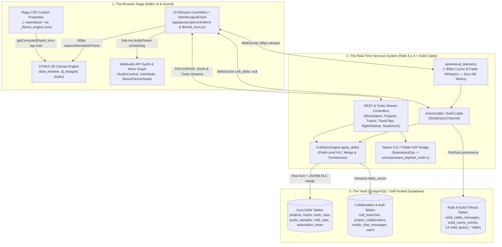
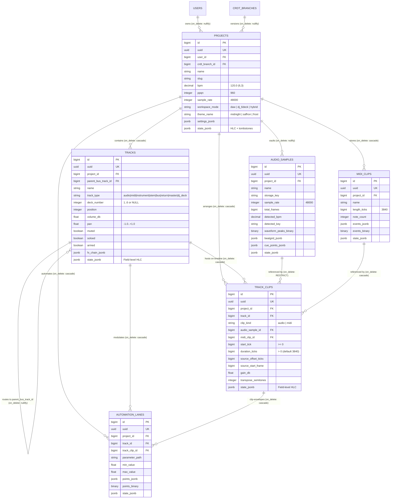
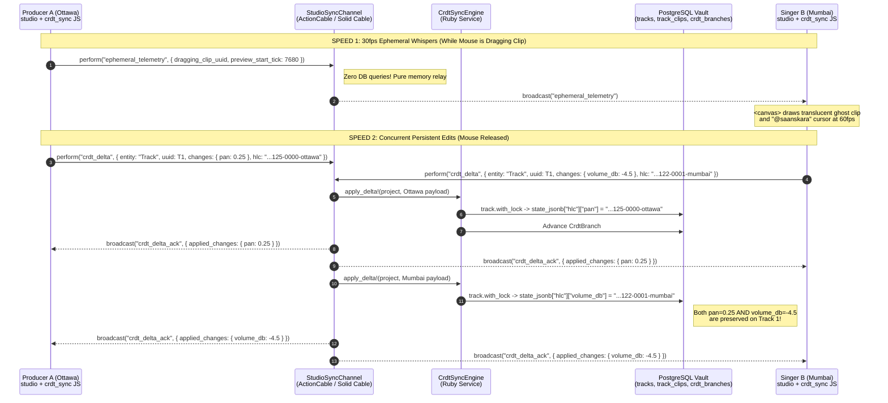
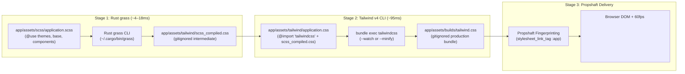

# Jyki (Saanskara Studio DAW) — Founder's Architectural Debrief & Systems Guide

> **Prepared for:** The Founder & Creative Director, Saanskara Studios  
> **System Version:** Ruby `4.0.9` (YJIT/PRISM) • Ruby on Rails `8.1.4` • PostgreSQL (`Solid Cable` / `Solid Cache` / `Solid Queue`) • Native C11 (`Fiddle` DSP) • Rust `grass` + Tailwind v4  
> **Purpose:** A plain-English, studio-metaphor guide to every architectural layer, database table, real-time collaboration protocol, and file in the **Jyki** repository.

---

## Table of Contents

1. [Executive Summary: What Jyki Is & How the Engine Works (The 30,000-Foot View)](#1-executive-summary-what-jyki-is--how-the-engine-works-the-30000-foot-view)
2. [The "DAW Concepts Translated for Founders" Glossary](#2-the-daw-concepts-translated-for-founders-glossary)
3. [Guided Tour of the Database (`db/schema.rb` & `app/models/`)](#3-guided-tour-of-the-database-dbschemarb--appmodels)
4. [How the Real-Time Multi-User Collaboration Works (CRDTs + ActionCable)](#4-how-the-real-time-multi-user-collaboration-works-crdts--actioncable-without-the-phd-jargon)
5. [The Frontend Architecture: Canvas, WebAudio & Stimulus (`app/javascript/` & `app/views/`)](#5-the-frontend-architecture-canvas-webaudio--stimulus-appjavascript--appviews)
6. [The Raga Theme Engine & Lean CSS Pipeline (`app/assets/scss/` & `bin/css-pipeline`)](#6-the-raga-theme-engine--lean-css-pipeline-appassetsscss--bincss-pipeline)
7. [Server Telemetry, Scripts & Deployment Map (`config/initializers/`, `bin/`, `Dockerfile`)](#7-server-telemetry-scripts--deployment-map-configinitializers-bin-dockerfile)
8. [Complete File-by-File Map of the Repository](#8-complete-file-by-file-map-of-the-repository)
9. [Founder's Playbook: "Where Do I Go To Change X?" & Next Milestones](#9-founders-playbook-where-do-i-go-to-change-x--next-milestones)

---

## 1. Executive Summary: What Jyki Is & How the Engine Works (The 30,000-Foot View)

### Dual Identity: Studio Arrangement DAW + 6-Deck Live DJ Workstation

Most music software forces artists into a false choice:
- **Arrangement DAWs** (like Pro Tools, Logic, or Ableton's Arrangement View) are built for composing horizontal timelines of audio stems, MIDI melodies, and automation curves.
- **Live Performance DJ Consoles** (like Rekordbox, Serato, or Traktor) are built for phase-locking multiple decks, riding crossfaders, triggering hot cues, and matching Camelot keys in real time.

**Jyki** fuses both worlds into a single browser-native instrument without reloading the page:
1. **Multi-Track DAW Mode (`workspace_mode: "daw"` / Create Workspace):** A horizontal bar-and-beat timeline with multi-track headers, non-destructive audio and MIDI clips, a Session/Ideas clip launcher matrix, a 32-bit float mixer rack, and smooth automation lanes.
2. **6-Deck Live DJ Workstation (`workspace_mode: "dj_6deck"` / DJ Mode):** Six simultaneous phase-locked platters (**Decks 1–6** / **Decks A–F**) with Camelot harmonic key matching (`8A • C Bhairavi`), tempo/pitch bend sliders, 3-band EQ kills, A/B/Thru crossfader routing, hot cues, and a live phase-alignment beatgrid scope.

### Why Jyki Achieves 60fps Without React or Next.js Bloat

If you build a DAW in React, Next.js, or Vue, moving a playhead 60 times per second triggers a "Virtual DOM diffing" cycle across thousands of HTML nodes. Within minutes, browser memory swells, garbage collection pauses kick in, and the playhead stutters while audio crackles.

Jyki follows our **Lean & Feature-Rich Mandate**, bypassing heavy JavaScript frameworks completely:
- **HTML5 2D `<canvas>` for 60fps Graphics:** Instead of creating thousands of DOM `<div>` elements for waveforms and MIDI notes, Jyki draws the timeline, playhead, beatgrids, waveforms, and collaborator ghost cursors directly onto GPU-accelerated `<canvas>` elements inside a `requestAnimationFrame` loop (`daw_timeline_controller.js`, `dj_beatgrid_controller.js`, `studio_controller.js`).
- **WebAudio API for Real-Time Sound:** Sound synthesis, 16th-note lookahead scheduling, per-track stereo panning (`StereoPannerNode`), and decibel gain staging (`GainNode`) run inside the browser's dedicated C++ audio thread (`AudioContext`), isolated from UI rendering.
- **Hotwire (`Turbo` + `Stimulus`) for Surgical HTML Updates:** Structural changes—like adding a track, posting a studio chat message, or committing a branch—use **Turbo Streams** over the wire, swapping only the exact DOM fragment in under 15ms.
- **Rails 8 "Solid Trifecta" on PostgreSQL:** Real-time WebSockets (`Solid Cable`), caching (`Solid Cache`), and background jobs (`Solid Queue`) all run inside **PostgreSQL**—meaning zero Redis servers to pay for or maintain.

> **Architectural Note — Two Live Studio Shells in the Repo:**  
> Jyki provides two live routes so you can inspect both the modular multi-controller workstation and the self-contained CRDT reference shell:
> - **`GET /` (`WorkstationController#index` -> `app/views/workstation/index.html.erb`):** The primary 5-zone modular SPA shell (`Jaku Workstation Session`) powered by coordinated Stimulus controllers (`workstation`, `daw-timeline`, `dj-deck`, `dj-beatgrid`, `mixer`, `right-sidebar`, `auth-drawer`).
> - **`GET /home` & `GET /studio` (`HomeController#index` -> `app/views/home/index.html.erb`):** The full-stack database-hydrated Raga DAW shell (`Saanskara Raga Session 01`, seeded by `StudioBootstrapper`) wired to `studio_controller.js` and `crdt_sync_controller.js`.

### High-Level 3-Layer System Architecture



---

## 2. The "DAW Concepts Translated for Founders" Glossary

Before diving into the database and code, here is your executive translation matrix for the six core audio engineering concepts that power Jyki.

### Quick-Reference Translation Matrix

| DAW Concept | Schema Columns / Values | Everyday Studio Analogy | Business & Performance Payoff | Primary Code Locations |
| :--- | :--- | :--- | :--- | :--- |
| **1. PPQN (`960` Ticks)** | `projects.ppqn = 960`<br/>`track_clips.start_tick`<br/>`track_clips.duration_ticks` | **Sheet Music Ruler vs. Stopwatch:** Measuring where a drum hit sits as "Beat 2 of Bar 1" (`tick 960`) instead of "at 0.48 seconds." | Changing BPM from `120` to `140` speeds up the whole song instantly without recalculating or breaking a single clip position. | `app/models/project.rb` (`#ticks_to_seconds`, `#seconds_to_ticks`)<br/>`app/models/track_clip.rb` (`#end_tick`) |
| **2. Sample Rate (`48,000 Hz`) & Frames** | `sample_rate = 48000`<br/>`total_frames`<br/>`source_start_frame` | **A 48,000 fps Film Reel:** Digital sound is a movie strip with 48,000 microscopic air-pressure snapshots ("frames") every single second. | Sub-millisecond surgical trimming and phase-locked synchronization without floating-point rounding drift. | `app/models/audio_sample.rb`<br/>`app/models/project.rb` (`#ticks_to_frames`)<br/>`db/schema.rb` (`audio_samples`) |
| **3. Master Blueprint vs. Timeline Placement** | `AudioSample` / `MidiClip`<br/>*vs.*<br/>`TrackClip` | **Master Vinyl Record vs. Sticky Notes on a Score:** The recording sits once in the vault; timeline clips are tiny sticky notes saying *"Play the Sitar recording from Bar 1 to Bar 3."* | **Non-Destructive Editing:** Duplicating a vocal chop 50 times takes ~200 bytes per clip instead of copying a 50MB `.wav` file 50 times. | `app/models/audio_sample.rb`<br/>`app/models/midi_clip.rb`<br/>`app/models/track_clip.rb` |
| **4. Unified Tracks, Buses & 6 DJ Decks** | `tracks.track_type`<br/>`tracks.deck_number` (`1..6`)<br/>`parent_bus_track_id` | **A Transforming Mixing Console:** One physical channel strip that can act as a mic channel, synth input, group submixer ("Bus"), or one of 6 DJ turntables. | A single unified table powers both the DAW arrangement and the 6-Deck DJ view—switching modes requires zero data migration. | `app/models/track.rb`<br/>`app/services/studio_bootstrapper.rb` (`DEFAULT_TRACKS`) |
| **5. Automation Lanes** | `automation_lanes`<br/>`parameter_path`<br/>`points_jsonb` / `points_binary` | **Player-Piano Ghost Hands:** Recording the movement of a fader or filter knob so an "invisible engineer's hand" turns it smoothly during playback. | Stores thousands of expressive parameter movements in compact JSONB or packed binary floats (`pack("e*")`) for 60fps curve rendering. | `app/models/automation_lane.rb`<br/>`app/services/studio_bootstrapper.rb` (lines 522–546) |
| **6. Waveform Peaks** | `waveform_peaks_binary`<br/>`dsp_metadata_jsonb["peaks"]` | **Map Thumbnail vs. Raw Satellite Data:** Pre-calculating a miniature silhouette of the audio wave instead of sending millions of raw samples to the screen. | Allows `<canvas>` to draw 20+ tracks at 60fps on a laptop or tablet using a few hundred bytes per clip instead of gigabytes of RAM. | `app/services/studio_bootstrapper.rb` (`#extract_waveform_peaks`, `#create_default_audio_sample!`) |

---

### Deep-Dive Concept Translations

#### 2.1 PPQN (`960` Pulses Per Quarter Note / `start_tick` & `duration_ticks`)
- **What It Means in Plain English (The Analogy):**  
  Imagine writing a choreography script. If you write *"Dancer jumps at 2.00 seconds,"* and the band decides to play the song slightly faster (say, 128 BPM instead of 120 BPM), your entire script is ruined—2.00 seconds is no longer on the downbeat! Instead, musicians write *"Dancer jumps on Bar 2, Beat 1."*  
  In a professional DAW, **PPQN (Pulses Per Quarter Note)** slices every single quarter-note beat into **960 microscopic musical ticks**:
  - **1 Quarter Note (1 Beat)** = `960 ticks`
  - **1 Sixteenth Note (`1/16`)** = `240 ticks`
  - **1 Full Bar in 4/4 Time (4 Beats)** = `3,840 ticks` (`960 × 4`)
  - **2 Full Bars** = `7,680 ticks`
- **Why We Built It This Way:**  
  Because `960` is divisible by `2, 3, 4, 5, 6, 8, 10, 12, 15, 16, 20, 24, 30, 32, 40, 48, 60, 64...`, Jyki can represent straight 16th notes, jazz swing, and Indian classical *Taal* triplets or quintuplets using **pure integers** (`bigint`) with zero ugly decimal rounding (`0.3333333...`). And when you drag the BPM slider from `124.0` to `130.0`, every `TrackClip` stays locked to its exact musical bar without touching a single clip row in PostgreSQL.
- **Where the Magic Lives in Code:**
  - `db/schema.rb`: `projects.ppqn` (default `960`), `track_clips.start_tick` (`bigint`), `track_clips.duration_ticks` (`bigint`, default `3840`).
  - `app/models/project.rb` (lines 30–40):
    ```ruby
    def ticks_to_seconds(ticks)
      return 0.0 if bpm.to_f <= 0.0 || ppqn.to_i <= 0
      (ticks.to_f * 60.0) / (bpm.to_f * ppqn.to_f)
    end
    ```
  - `app/models/track_clip.rb` (lines 51–53): `TrackClip#end_tick` computes `start_tick.to_i + duration_ticks.to_i`, and `scope :in_tick_range` queries overlapping clips on the timeline using fast B-tree index lookups (`idx_on_track_id_start_tick_duration_ticks_235a3c35a4`).

---

#### 2.2 Sample Rate (`48,000 Hz`) & Frames (`total_frames`, `source_start_frame`)
- **What It Means in Plain English (The Analogy):**  
  A cinema movie is actually a strip of still photographs flashed on screen at 24 frames per second. Digital audio works the exact same way, except human ears are much faster than human eyes. At broadcast/studio standard **48,000 Hz (`48kHz`)**, Jyki captures **48,000 instantaneous snapshots ("Sample Frames")** of the speaker cone's position every single second. Since our tracks are stereo (`channels: 2`), each **Frame** holds one Left-ear measurement and one Right-ear measurement at **24-bit** studio resolution (`bit_depth: 24`).
- **Why We Built It This Way:**  
  While musical arrangement happens in **Ticks** (which stretch when BPM changes), raw audio recordings exist in physical **Sample Frames**. Storing `total_frames`, `trim_start_frame`, and `source_start_frame` as 64-bit integers (`bigint`) lets Jyki slice a vocal syllable or align a tabla transient down to **1/48,000th of a second (20.8 microseconds)**—eliminating the hollow "phasing" sound that happens when two drums are slightly out of alignment.
- **Where the Magic Lives in Code:**
  - `db/schema.rb`: `audio_samples` table (`sample_rate: 48000`, `channels: 2`, `bit_depth: 24`, `total_frames`, `trim_start_frame`, `trim_end_frame`) and `track_clips` table (`source_start_frame`, `source_end_frame`).
  - `app/models/project.rb` (lines 42–50): `#ticks_to_frames(ticks)` and `#frames_to_ticks(frames)` bridge musical time (`ticks`) and physical audio hardware time (`frames`).

---

#### 2.3 The Master Blueprint vs. The Timeline Placement (`AudioSample` / `MidiClip` vs. `TrackClip`)
- **What It Means in Plain English (The Analogy):**  
  Think of an **`AudioSample`** (a recorded Sitar `.wav` file) or a **`MidiClip`** (a 16-beat Tabla sheet-music pattern) as a **Master Vinyl Record** kept safely inside a glass vault.  
  When you drag that Sitar recording onto Bar 1 and Bar 5 of your song, you are **not** photocopying the vinyl record. Instead, you are placing two lightweight **Sticky Notes**—called **`TrackClip`s**—onto your timeline sheet.
  - Sticky Note #1 (`TrackClip`) says: *"Play `sitar_sample` starting at Bar 1 (`start_tick: 0`) for 2 bars (`duration_ticks: 7680`) at normal volume (`gain_db: 0.0`)."*
  - Sticky Note #2 (`TrackClip`) says: *"Play that exact same `sitar_sample` starting at Bar 5 (`start_tick: 15360`), skipping the first beat (`source_offset_ticks: 960`), boosted by `+1.5 dB` (`gain_db: 1.5`)."*
- **Why We Built It This Way (Non-Destructive Editing):**  
  1. **Zero Storage Duplication:** Whether a producer loops a 50MB drum stem 4 times or 400 times across a song, cloud storage holds **one** master file (`AudioSample`), while PostgreSQL stores tiny `TrackClip` rows.
  2. **Instant Undo & Fearless Experimentation:** Slicing a clip in half, pitching it up 3 semitones (`transpose_semitones: 3`), or fading it in (`fade_in_ticks: 1920`) only changes numbers on the `TrackClip` sticky note. The original `AudioSample` is never harmed.
  3. **Database-Enforced Integrity:** PostgreSQL enforces a strict check constraint (`check_track_clips_source_matches_kind`) guaranteeing every `TrackClip` points to *either* an `AudioSample` (when `clip_kind = 'audio'`) *or* a `MidiClip` (when `clip_kind = 'midi'`), never both or neither.
- **Where the Magic Lives in Code:**
  - `app/models/audio_sample.rb`, `app/models/midi_clip.rb`, and `app/models/track_clip.rb` (`#source_matches_clip_kind`).
  - `app/services/studio_bootstrapper.rb` (lines 411–435): Look at how `sitar_sample` is created once on line 371, and then referenced by both `"Sitar Alaap Intro"` (`start_tick: 0`) and `"Sitar Jhala Peak"` (`start_tick: 15360`).

---

#### 2.4 Tracks, Buses & 6 DJ Decks (`tracks` Table)
- **What It Means in Plain English (The Analogy):**  
  In a physical recording studio, cables run from individual instruments (Sitar, Tabla, Vocal) into **Channel Strips** on a mixing desk. Engineers often group several channels together—say, all drum mics—into a single master fader called a **Submix Bus** (`track_type: "bus"` via `parent_bus_track_id`) so they can compress or mute all drums with one hand. And in a DJ booth, those same channels feed **Turntable Decks 1 through 6** (`deck_number: 1..6`).  
  In Jyki, all of these live in a single unified **`tracks`** table.
- **Why We Built It This Way:**  
  Instead of maintaining separate tables for `daw_tracks`, `mixer_buses`, and `dj_decks`, a single `Track` record carries:
  - `track_type`: enum supporting `audio`, `midi`, `instrument`, `stem`, `bus`, `return`, `master`, and `dj_deck`.
  - `deck_number`: integer constrained by PostgreSQL (`check_tracks_deck_number_range`) to `1..6` (or `NULL` for pure auxiliary buses).
  - `parent_bus_track_id`: self-referential foreign key allowing any track to route its audio output into a parent `bus` or `master` track!
  When an artist clicks the **DJ** pill in the top bar, Jyki doesn't have to convert or export the project—Tracks 1–6 immediately become **DJ Decks 1–6** with their existing audio stems, cue points, and FX chains intact.
- **Where the Magic Lives in Code:**
  - `app/models/track.rb` (lines 4–29): Self-referential `belongs_to :parent_bus_track` / `has_many :child_tracks`, `enum :track_type`, and `validates :deck_number, inclusion: { in: 1..6 }`.
  - `app/services/studio_bootstrapper.rb` (`DEFAULT_TRACKS`, lines 6–98): Seeds the 6 signature tracks mapped to `deck_number: 1..6`.

---

#### 2.5 Automation Lanes (`automation_lanes`)
- **What It Means in Plain English (The Analogy):**  
  Have you ever watched a mixing engineer slowly push a vocal fader up during a quiet verse and pull it back slightly during a loud chorus, or slowly twist a filter knob from muffled (`420 Hz`) to bright (`16,500 Hz`) right before a beat drop?  
  An **Automation Lane** is like a player-piano roll for knobs and faders. You place dots ("breakpoints") along the timeline—e.g., *at Bar 3 (`tick 7680`), set Filter Cutoff to `420 Hz`; by Bar 5 (`tick 15360`), sweep it up to `16,500 Hz` with a smooth curve (`curve: 0.4`)*—and Jyki's engine turns that knob automatically every time the song plays.
- **Why We Built It This Way:**  
  Each `AutomationLane` stores a dot-separated `parameter_path` (such as `"mixer.volume_db"` or `"dj.deck_5.filter_cutoff"`), explicit `min_value` / `max_value` bounds (protected by PostgreSQL constraint `check_automation_lanes_min_max_range`), and dual storage for breakpoints:
  - `points_jsonb`: Human-readable JSON array (`[{ "tick" => 0, "value" => -3.0, "curve" => 0.0 }, ...]`) for instant inspection and CRDT syncing.
  - `points_binary`: Packed 32-bit little-endian IEEE 754 floats (`Array#pack("e*")`) so C/WebAssembly DSP kernels can stream thousands of curve points without parsing JSON strings.
- **Where the Magic Lives in Code:**
  - `db/schema.rb` (lines 52–73): `automation_lanes` table with composite index `index_automation_lanes_on_track_id_and_parameter_path`.
  - `app/models/automation_lane.rb` and `app/services/studio_bootstrapper.rb` (lines 522–546).

---

#### 2.6 Waveform Peaks (`waveform_peaks_binary` & `dsp_metadata_jsonb["peaks"]`)
- **What It Means in Plain English (The Analogy):**  
  A 3-minute stereo song at `48,000 Hz` contains **17,280,000 individual numbers**. If the browser tried to read all 17 million numbers every 16 milliseconds just to draw a 200-pixel-wide rectangle on your screen, your laptop fan would spin up like a jet engine and the screen would freeze.  
  Instead, Jyki pre-calculates **Waveform Peaks**—think of it like generating a crisp **thumbnail silhouette** of a mountain range instead of measuring every pebble on the mountain.
- **Why We Built It This Way:**  
  When an `AudioSample` is registered, Jyki stores a compact array of normalized peak amplitudes (`-1.0` to `+1.0`) both as binary float bytes in `waveform_peaks_binary` (`peaks.pack("e*")` / `unpack("e*")`) and in `dsp_metadata_jsonb["peaks"]`. When the HTML5 `<canvas>` draws 60 frames per second, it iterates over just 32 to 64 peak bars per clip—rendering an entire multi-track arrangement in **less than 0.4 milliseconds per frame**.
- **Where the Magic Lives in Code:**
  - `app/services/studio_bootstrapper.rb`: `#create_default_audio_sample!` (line 351: `waveform_peaks_binary: peaks.pack("e*")`) and `#extract_waveform_peaks(sample)` (lines 558–571: `sample.waveform_peaks_binary.unpack("e*")`).
  - `app/javascript/controllers/daw_timeline_controller.js` & `app/javascript/controllers/studio_controller.js`: Draw those peak arrays directly onto the 2D `<canvas>`.

---

## 3. Guided Tour of the Database (`db/schema.rb` & `app/models/`)

Jyki runs on a **single PostgreSQL database** (`jyki_development` locally; self-hosted Supabase PostgreSQL in production via `SUPABASE_DB_URL`). This single database houses **10 core application tables** plus the **16 Rails 8 Solid Trifecta infrastructure tables**.

### 3.1 Entity-Relationship Diagram (Core Studio Schema)



> **Critical Studio Safety Rule (`on_delete: :restrict` on `audio_samples`):**  
> Look closely at `db/schema.rb` line 456 and `app/models/audio_sample.rb` line 5:
> - `add_foreign_key "track_clips", "audio_samples", on_delete: :restrict` (`has_many :track_clips, dependent: :restrict_with_error`)
> - `add_foreign_key "audio_samples", "projects", on_delete: :nullify`  
> **Why?** In a professional studio, deleting a `Track` cascades and cleans up its timeline `TrackClip` sticky notes (`on_delete: :cascade`). Even deleting an entire `Project` only *unlinks* its `AudioSample` recordings (`on_delete: :nullify`) rather than destroying the master audio vault! Furthermore, PostgreSQL physically forbids deleting an `AudioSample` (`:restrict`) as long as any `TrackClip` on any timeline still references it—preventing accidental "missing audio file" disasters during a live session.

---

### 3.2 Walkthrough of the 10 Application Tables

#### 1. `projects` (`app/models/project.rb`)
- **Studio Role:** The Master Session Tape Box. Holds global musical timing, scale/raga settings, active workspace mode, active visual theme, and project-wide CRDT tombstones.
- **Key Columns & Defaults:**
  - `uuid` (unique UUID), `name`, `slug` (auto-generated in `#ensure_project_identifiers` as `"#{name.parameterize}-#{uuid.split('-').first}"`).
  - `bpm` (`decimal(6,3)`, default `120.0`, check constraint `bpm > 0`), `time_signature_numerator` (`4`), `time_signature_denominator` (`4`), `ppqn` (`960`), `sample_rate` (`48000`).
  - `root_note` (`60` = Middle C / C4), `scale_name` (e.g., `"bhairavi"`, `"yaman"`, `"kafi"`, `"todi"`, `"chromatic"`).
  - `master_volume_db` (`0.0`), `swing_amount` (`0.0`), `workspace_mode` (`enum`: `"daw"`, `"dj_6deck"`, `"hybrid"`), `theme_name` (`"midnight"`).
  - `settings_jsonb` (stores `snap_ticks`, `loop_bars`, `crossfader`, `quantize`), `state_jsonb` (stores field HLC clocks and deleted entity `tombstones`), `lock_version` (optimistic locking).

#### 2. `tracks` (`app/models/track.rb`)
- **Studio Role:** A channel strip on the mixing board—or one of the 6 DJ Decks.
- **Key Columns & Defaults:**
  - `project_id` (FK, cascade delete), `parent_bus_track_id` (self-FK to another `Track` for submix bus routing, nullify on delete).
  - `name`, `track_type` (`enum`: `audio`, `midi`, `instrument`, `stem`, `bus`, `return`, `master`, `dj_deck`), `deck_number` (`1..6` enforced by DB check constraint `check_tracks_deck_number_range`).
  - `position` (vertical display order), `color_hex` (`"#f59e0b"`), `volume_db` (`0.0`), `pan` (`-1.0` full left to `+1.0` full right, enforced by `check_tracks_pan_range`).
  - `muted`, `soloed`, `armed` (record arm), `input_routing_jsonb` (stores channel metadata, noise-reduction `nr` toggle, and workstation clip summaries), `fx_chain_jsonb` (array of active DSP plugins like `saanskara_spanda_eq`, `saanskara_comb_reverb`, `saanskara_tape_saturator`), and `state_jsonb`.

#### 3. `audio_samples` (`app/models/audio_sample.rb`)
- **Studio Role:** The Master Audio Vault. Represents an immutable recorded audio file (`.wav`/`.flac`) and its pre-analyzed DJ metadata.
- **Key Columns & Defaults:**
  - `name`, `storage_key` (path in object storage, e.g., `"samples/sitar_bhairavi_alap_124bpm.wav"`), `checksum_sha256` (content hash for deduplication).
  - `sample_rate` (`48000`), `channels` (`2`), `bit_depth` (`24`), `total_frames`, `trim_start_frame`, `trim_end_frame`, `duration_ms`.
  - `detected_bpm` (`decimal(6,3)`), `detected_key` (Camelot + Raga notation, e.g., `"8A • C Bhairavi"`), `peak_db`, `integrated_lufs` (broadcast loudness standard, e.g., `-11.4`), `is_loop`.
  - `waveform_peaks_binary` (packed 32-bit float peaks `pack("e*")`), `beatgrid_jsonb` (tick/bar/beat markers for DJ sync), `cue_points_jsonb` (4 color-coded DJ hot cues: *Sam, Drop, Alaap, Outro*), `dsp_metadata_jsonb`.

#### 4. `midi_clips` (`app/models/midi_clip.rb`)
- **Studio Role:** The Digital Sheet Music Roll. Stores note events (pitch, velocity, start tick, duration tick, MIDI channel) that can trigger any synthesizer or tabla sampler.
- **Key Columns & Defaults:**
  - `name`, `length_ticks` (default `3840` = 1 bar), `note_count`.
  - `events_jsonb`: Array of note hashes, e.g., `{ "t" => 0, "d" => 240, "n" => 60, "v" => 120, "ch" => 9 }` (`t` = start tick, `d` = duration ticks, `n` = MIDI note `0..127`, `v` = velocity `0..127`, `ch` = MIDI channel).
  - `events_binary`: Ultra-compact 12-byte-per-note binary buffer (`pack("V2C4" * notes.size)`) ready for zero-parse C/Wasm playback.
  - `groove_template_jsonb` & `state_jsonb`.

#### 5. `track_clips` (`app/models/track_clip.rb`)
- **Studio Role:** The Non-Destructive Timeline Placement ("Sticky Note"). Places an `AudioSample` or `MidiClip` at a specific bar/tick on a `Track`.
- **Key Columns & Defaults:**
  - `clip_kind` (`"audio"` or `"midi"`), `audio_sample_id`, `midi_clip_id` (guarded by `check_track_clips_source_matches_kind`).
  - `start_tick` (`>= 0`), `duration_ticks` (`> 0`, default `3840`), `source_offset_ticks` (aliased as `offset_ticks`), `source_start_frame` (aliased as `trim_start_frame`), `source_end_frame` (`trim_end_frame`).
  - `loop_enabled`, `loop_start_tick`, `loop_end_tick`.
  - Per-clip non-destructive DSP overrides: `gain_db` (`0.0`), `transpose_semitones` (`0`), `detune_cents` (`0.0`, aliased as `pitch_cents`), `warp_enabled` (`true`), `warp_algorithm` (`beats`, `tones`, `complex`, `repitch`), `time_stretch_ratio` (`1.0`), `fade_in_ticks`, `fade_out_ticks`, `fade_curve` (`-1.0..1.0`), `muted`, `warp_markers_jsonb`, and `state_jsonb`.

#### 6. `automation_lanes` (`app/models/automation_lane.rb`)
- **Studio Role:** Automated parameter envelopes attached to a `Project`, a `Track`, or a specific `TrackClip`.
- **Key Columns & Defaults:**
  - `parameter_path` (e.g., `"mixer.volume_db"`, `"dj.deck_5.filter_cutoff"`), `min_value`, `max_value`, `bypassed` (`false`).
  - `points_jsonb` (array of `{ "tick", "value", "curve" }` breakpoints) and `points_binary` (`pack("e*")` float stream).

#### 7. `crdt_branches` (`app/models/crdt_branch.rb`)
- **Studio Role:** Git-style Version Snapshots for Music Sessions. Lets producers commit a mix state (e.g., `"main (master-bus-locked)"` or `"alt-808-saturation-pass"`) and switch between branches without losing ideas.
- **Key Columns & Defaults:**
  - `name`, `delta_vector` (Base64-encoded CRDT state vector hash, e.g., `"AQT/AQABc2FhbnNreXJkdW1Rhdw=="`, updated on every `CrdtSyncEngine.apply_delta!`), and `committed_at_label` (e.g., `"17:12 UTC"`).

#### 8. `project_collaborators` (`app/models/project_collaborator.rb`)
- **Studio Role:** Studio Access Control List (ACL) Roster. Defines who is invited into a project session and what permissions they hold.
- **Key Columns & Defaults:**
  - `project_slug` (e.g., `"proj_default"` or the project's unique slug), `username` (normalized lowercase without `@`, unique per `project_slug`), `external_user_id`, `email`.
  - `role`: Validated against `ProjectCollaborator::ACL_ROLES` (`"EDITOR"`, `"COLLABORATOR"`, `"VIEWER"`), plus `added_at_label`.

#### 9. `studio_chat_messages` (`app/models/studio_chat_message.rb`)
- **Studio Role:** Real-Time Control Room Intercom. Powers the live chat feed inside the right sidebar so producers and mastering engineers can leave timestamped mix notes.
- **Key Columns & Defaults:**
  - `sender_name`, `sender_role` (`"OWNER"`, `"EDITOR"`, `"COLLABORATOR"`), `body` (max 1000 chars), `room_type` (`"project_room"` or `"dm"`), `recipient_handle`, `sent_at_label`.
  - Includes an `after_create_commit` callback that automatically broadcasts new messages via Turbo Streams (`broadcast_append_to "jyki_project_chat", target: "jyki_chat_messages"`).

#### 10. `users` (`app/models/user.rb`)
- **Studio Role:** Producer Identity, Authentication & Subscription Tier Profile.
- **Key Columns & Defaults:**
  - Full **Devise** authentication suite (`email`, `encrypted_password`, `reset_password_token`, `sign_in_count`, `confirmation_token`, `failed_attempts`, `unlock_token`, `stretches: 10`) + **Google OAuth2 OmniAuth** (`provider`, `uid`, `User.from_omniauth`).
  - Studio attributes: `username`, `display_name` (`"Saanskara"`), `avatar_url`, `storage_node_id`, `studio_plan` (`"studio_master"`, `"producer_pro"`, `"indie_creator"`), `studio_plan_tier` (`"studio_master_192_64"`, `"producer_pro_96_32"`, `"indie_creator_48_24"`), `project_role` (`"owner"`, `"editor"`, `"collaborator"`, `"viewer"`), and `role`.
  - `User#effective_permissions` computes a 7-row capability matrix (DSP write, Sample upload, CRDT commit, Cloud sync, 96kHz/192kHz lossless export, ACL management, Studio chat) rendered inside the Studio Auth Drawer.

---

### 3.3 The Rails 8 "Solid Trifecta" Tables in `db/schema.rb`

Instead of running external Redis and Sidekiq processes, Jyki stores its real-time pub/sub bus, cache, and background job queues in the same PostgreSQL database:

| Table Group | Table Names in `db/schema.rb` | What It Replaces | Role in Jyki |
| :--- | :--- | :--- | :--- |
| **Solid Cable** | `solid_cable_messages` | Redis Pub/Sub | Relays ActionCable WebSocket broadcasts (`StudioSyncChannel` CRDT deltas, ephemeral cursor telemetry, and Turbo Stream chat updates) across Puma worker processes. |
| **Solid Cache** | `solid_cache_entries` | Redis / Memcached | Stores encrypted/hashed key-value cache payloads (`key_hash`, `byte_size`) on fast NVMe disk storage in production. |
| **Solid Queue** | `solid_queue_jobs`, `solid_queue_ready_executions`, `solid_queue_scheduled_executions`, `solid_queue_claimed_executions`, `solid_queue_blocked_executions`, `solid_queue_failed_executions`, `solid_queue_batches`, `solid_queue_batch_executions`, `solid_queue_pauses`, `solid_queue_processes`, `solid_queue_recurring_executions`, `solid_queue_recurring_tasks`, `solid_queue_semaphores` | Redis + Sidekiq / BullMQ | Manages transactional background job queues, recurring maintenance tasks, and concurrency semaphores using PostgreSQL `FOR UPDATE SKIP LOCKED`. |

---

## 4. How the Real-Time Multi-User Collaboration Works (CRDTs + ActionCable Without the PhD Jargon)

### 4.1 The Studio Scenario: Ottawa vs. Mumbai at the Exact Same Millisecond

Imagine **Producer A in Ottawa** (`@saanskara`) and **Singer B in Mumbai** (`@aria_mastering`) are logged into the same Jyki project (`Saanskara Raga Session 01`) at the exact same moment:
- In **Ottawa**, Producer A pans **Track 01 (Sitar Lead)** slightly to the right (`pan: 0.25`).
- At the **exact same millisecond in Mumbai**, Singer B lowers the volume of **Track 01 (Sitar Lead)** by 3 decibels (`volume_db: -4.5`).

In a traditional web application, both browsers send a "Save Track 01" request to the server. Whoever's packet arrives 10 milliseconds later **overwrites the entire database row**—wiping out the other artist's adjustment! Even worse, if they locked the track while editing, the studio would feel sluggish and unresponsive.

### 4.2 Our Solution Part 1: Field-Level CRDTs & Hybrid Logical Clocks (`HLC`)

Jyki solves this using a **Field-Level Last-Write-Wins Element-Map CRDT** powered by **Hybrid Logical Clocks (`HLC`)**.

#### The Analogy: Individual Time-Stamped Sticky Labels on Every Knob
Instead of putting one single "Last Saved" timestamp on the entire Track 01 channel strip, Jyki attaches an **individual micro-timestamp sticker** to *every single knob and button* inside that track's `state_jsonb["hlc"]` column:

```json
{
  "hlc": {
    "pan": "1731273600125-0000-node_ottawa",
    "volume_db": "1731273600122-0001-node_mumbai",
    "muted": "1731273590000-0000-node_ottawa"
  },
  "tombstone": false,
  "last_actor": "saanskara",
  "last_hlc": "1731273600125-0000-node_ottawa"
}
```

When Producer A's `pan` change and Singer B's `volume_db` change hit `CrdtSyncEngine.apply_delta!`:
1. PostgreSQL acquires a sub-millisecond row lock (`record.with_lock` in `app/services/crdt_sync_engine.rb`, line 199).
2. For each changed field in `raw_changes`, Jyki compares the incoming HLC stamp against *only that specific field's* existing HLC stamp (`existing_field_hlc = hlc_map[canonical_field]`).
3. Because `pan` and `volume_db` are separate keys in `state_jsonb["hlc"]`, **both changes win and merge cleanly**! Neither artist ever overwrites the other's work.
4. Even if two artists twist the *exact same knob* (`volume_db`) while offline, the HLC format guarantees a deterministic, mathematically provable winner across every browser and server on earth:

```text
  1731273600125  -  0001  -  node_a8f2
  └─────┬─────┘    └──┬─┘    └───┬───┘
  13-digit Wall    4-digit   Unique Browser
  Clock (ms UTC)   Counter   Tab Node ID
```

- **Why a "Hybrid" Clock Instead of Just `Date.now()`?**  
  Computer clocks drift! If Producer A's laptop clock is 200ms behind Singer B's laptop clock, a naive wall-clock comparison would unfairly reject Producer A's edits. Whenever `HybridLogicalClock#receive(remoteHlcString)` (`app/javascript/lib/crdt_clock.js`, line 28) sees a message from a peer whose clock is slightly ahead, it automatically catches up to `Math.max(nowInt, this.lastWallMs, remote.wallMs)` and increments the 4-digit counter (`counter + 1`). Causal order is preserved even if a laptop's system clock is slightly off.

### 4.3 Tombstone Deletion Protection (Killing "Zombie Clips")

What if Producer A in Ottawa **deletes** a vocal clip at `t = 100`, while a delayed packet from Mumbai (sent at `t = 99` over slow hotel Wi-Fi) arrives at the server at `t = 101` trying to move that same clip to Bar 4?
- When a `Track`, `TrackClip`, `MidiClip`, or `AutomationLane` is deleted, `CrdtSyncEngine#apply_delete_delta!` (lines 305–355) records the entity's UUID and deletion HLC inside `project.state_jsonb["tombstones"][entity_uuid]`.
- Before applying any future `update` or `create` delta, `CrdtSyncEngine.apply_delta!` checks (lines 96–117):
  ```ruby
  tombstone_hlc = project.state_jsonb&.dig("tombstones", entity_uuid)
  if tombstone_hlc.present? && compare_hlc(incoming_hlc, tombstone_hlc) <= 0
    # Rejects stale packet with reason: "tombstoned" so deleted clips never rise from the grave!
  ```

### 4.4 Two-Speed Networking: 30fps Whispers vs. Permanent Vault Commits

If Jyki wrote a row to PostgreSQL every single pixel you moved your mouse while dragging a clip or riding a volume fader, a 2-second drag would fire 120 database transactions! Instead, Jyki uses **Two-Speed Networking** over `StudioSyncChannel`:

| Speed Tier | ActionCable Method | Frequency | Touches PostgreSQL? | What It Carries |
| :--- | :--- | :--- | :--- | :--- |
| **Speed 1: Fast Ephemeral Whispers** | `ephemeral_telemetry` | **~30 fps** (throttled to `33ms` in `crdt_sync_controller.js`) | **NO (`0` DB Queries)** | Live mouse cursor position (`cursor_tick`, `cursor_track_uuid`), translucent ghost clip drag preview (`dragging_clip_uuid`, `preview_start_tick`), and live fader movement (`live_fader`). |
| **Speed 2: Persistent CRDT Deltas** | `crdt_delta` $\rightarrow$ `crdt_delta_ack` (plus REST fallback) | **Once** on mouse-up or after `120–150ms` fader settle | **YES (`with_lock` + JSONB HLC merge)** | Canonical field updates (`start_tick`, `volume_db`, `pan`, `bpm`), HLC watermarks, and `CrdtBranch#delta_vector` advancement. |

### 4.5 Sequence Diagram: Ottawa & Mumbai Jamming Together



### 4.6 Files Powering Real-Time Collaboration

| File Path | Role in the Collaboration Stack |
| :--- | :--- |
| `app/services/crdt_sync_engine.rb` | The brains of conflict resolution: `MUTABLE_FIELDS` whitelist, `generate_hlc`, `compare_hlc`, `apply_delta!` (`create`, `update`, `delete`), tombstone enforcement, and `advance_project_branch!`. |
| `app/channels/studio_sync_channel.rb` | ActionCable WebSocket hub streaming `studio_project_<uuid>`: handles `crdt_delta`, `ephemeral_telemetry`, `chat_message`, `add_collaborator`, and `switch_or_snapshot_branch`. |
| `app/channels/application_cable/connection.rb` | Identifies WebSocket peers via Devise/Warden session cookies or guest node parameters (`client_node_id`, `guest_name`) and assigns deterministic avatar colors. |
| `app/javascript/lib/crdt_clock.js` | Browser-side `HybridLogicalClock` class implementing `now()`, `receive()`, `compare()`, `shouldApplyField()`, and `recordFieldWatermark()`. |
| `app/javascript/controllers/crdt_sync_controller.js` | Manages the ActionCable subscription, offline delta queue (`this.pendingDeltas` flushed in HLC order on reconnect), 30fps telemetry throttle, live peer avatar strip, and CRDT Vector Log drawer. |

---

## 5. The Frontend Architecture: Canvas, WebAudio & Stimulus (`app/javascript/` & `app/views/`)

### 5.1 How the Two View Templates & 10 Stimulus Controllers Fit Together

Jyki uses **zero global JavaScript state stores** (no Redux, no Zustand). Instead, HTML `data-*` attributes hold configuration values, and **10 focused Stimulus controllers** (`app/javascript/controllers/`) coordinate UI events, WebAudio synthesis, and `<canvas>` rendering:

| Stimulus Controller | File (`app/javascript/controllers/`) | Mounted On | Primary Responsibility |
| :--- | :--- | :--- | :--- |
| **`workstation`** | `workstation_controller.js` | `app/views/workstation/index.html.erb` (`#jaku_workstation`) | Master SPA coordinator for `/`: Create/DJ mode switching, Song/Ideas submodes, transport clock, master spectrogram meter, sound browser search, AI Lab, and track creation. |
| **`daw-timeline`** | `daw_timeline_controller.js` | `app/views/workstation/_timeline_canvas.html.erb` | Multi-backend (`WebGPU` / `WebGL2` / `Canvas2D`) 60fps arrangement grid renderer, clip drag/drop, ruler scrubbing, and interactive orange automation breakpoint curves. |
| **`mixer`** | `mixer_controller.js` | `app/views/workstation/index.html.erb` | Bottom Mixer Console & Track Header fader synchronization, WebAudio `GainNode` + `StereoPannerNode` de-zippered (`15ms` `setTargetAtTime`) smoothing, and `/workstation/mixer` persistence. |
| **`dj-deck`** | `dj_deck_controller.js` | `app/views/workstation/_dj_deck.html.erb` (×6 decks) | Individual DJ platter controls for Decks A–F: play/cue, pitch slider, 3-band EQ kills (`LOW`, `MID`, `HI`), stem isolation toggles (`VOX`, `DRM`, `BAS`, `MEL`), and crossfader assignment (`A`/`B`/`THRU`). |
| **`dj-beatgrid`** | `dj_beatgrid_controller.js` | `app/views/workstation/_dj_view.html.erb` | Top-of-DJ-view 60fps phase-alignment scope showing live beatgrid transient bars for all 6 decks so a DJ can visually lock beats together. |
| **`right-sidebar`** | `right_sidebar_controller.js` | `app/views/workstation/index.html.erb` | Dockable right utility drawer (Project Chat, Yjs/CRDT Branch Snapshots, Server Telemetry HUD, Session Notes) with `localStorage` state persistence. |
| **`auth-drawer`** | `auth_drawer_controller.js` | `app/views/workstation/index.html.erb` | Slide-over Studio Auth & Role/Plan Tier switcher drawer (`Studio Master 192kHz/64-bit`, `Producer Pro`, `Indie Creator` + Collaborator ACL management). |
| **`studio`** | `studio_controller.js` | `app/views/home/index.html.erb` (`#saanskara-daw`) | Self-contained full-stack DAW + 6-Deck DJ + WebAudio synthesizer + `<canvas>` timeline controller for `/home` and `/studio`, wired directly to REST & CRDT channels. |
| **`crdt-sync`** | `crdt_sync_controller.js` | `app/views/home/index.html.erb` (`#saanskara-daw`) | Real-time ActionCable (`StudioSyncChannel`) client, HLC watermark manager, offline delta queue, peer presence strip, and live CRDT vector feed. |
| **`theme-bootstrap`** | `theme_bootstrap_controller.js` | `app/views/layouts/application.html.erb` (`<body>`) | Restores the user's saved Raga theme (`midnight`, `saffron`, `frost`) on initial page load and listens for theme switch events. |

---

### 5.2 Step-by-Step Lifecycles of 4 Everyday User Actions

Here is the exact journey of a signal from your fingertip on the mouse or keyboard all the way to the speakers, `<canvas>`, and PostgreSQL database.

---

#### Lifecycle 1: Pressing **Play** on the Transport Bar (or Hitting `Spacebar`)

```text
[User Presses Spacebar or Clicks "▶ Play"]
       │
       ▼
1. Stimulus Handler:
   • workstation_controller.js#handleGlobalKeydown -> #togglePlay()
   • (or studio_controller.js#togglePlay() on /home)
       │
       ▼
2. Transport State Flip & AudioContext Wake-Up:
   • Flips playing state (this.playingValue = true / this.isPlaying = true)
   • Propagates data-daw-timeline-playing-value="true" to <canvas>
   • Resumes browser WebAudio API (this.audioCtx.resume()) if suspended
       │
       ▼
3. 60fps requestAnimationFrame Loop (daw_timeline_controller.js / studio_controller.js#startRenderLoop):
   • Measures exact elapsed frame time: dtSec = (now - lastFrameTime) / 1000
   • Advances musical playhead in PPQN ticks:
     ticksPerSecond = (bpm / 60.0) * 960
     currentTick = (prevTick + dtSec * ticksPerSecond) % totalTicks
       │
       ├──► 4A. WebAudio 16th-Note Lookahead Synth (studio_controller.js#triggerSynthStepIfNeeded):
       │    • Whenever playhead crosses a 240-tick (1/16th note) boundary:
       │    • Checks unmuted tracks (respecting Solo state)
       │    • Spawns WebAudio OscillatorNode + GainNode + StereoPannerNode
       │    • Applies track.volume_db & track.pan and plays Raga scale notes!
       │
       └──► 4B. 60fps Canvas Redraw & Digital LCD Clock:
            • Formats Bar : Beat : Tick readout (e.g., "002 : 03 : 480")
            • Redraws playhead line and glowing active clip borders on <canvas>
```

- **Why Does Pressing Play Not Query PostgreSQL?**  
  Playback is a real-time local clock calculation (`ticksPerSecond = (bpm / 60.0) * 960`). By keeping playhead movement inside `requestAnimationFrame` and the browser's hardware `AudioContext`, pressing Play responds in **under 1 millisecond** with zero network lag.

---

#### Lifecycle 2: Dragging a **Clip** to a New Bar on the DAW Canvas

```text
[1. Mouse Down on a Clip on the <canvas>]
   • studio_controller.js#onCanvasPointerDown(event)
   • Converts mouse (x, y) pixels into (clickTick, trackIndex)
   • Hit-tests track.clips to find the clicked clip (start_tick <= clickTick <= start_tick + duration_ticks)
   • Records this.dragState = { clip, track, grabOffsetTicks }
       │
       ▼
[2. Mouse Move Across Bars (60fps Local + 30fps Network Whisper)]
   • studio_controller.js#onCanvasPointerMove(event)
   • Snaps rawTick to the musical grid (snapTicks = 240 for 1/16th note, or 960 for 1 beat):
     snappedTick = Math.round(rawStartTick / snapTicks) * snapTicks
   • Updates clip.start_tick (and clip.track_id if dragged vertically onto another track lane!)
   • Immediately redraws <canvas> at 60fps (this.renderTimelineCanvas())
   • Fires CustomEvent("crdt:local-telemetry") -> crdt_sync_controller.js#onLocalTelemetry:
     Sends 30fps "ephemeral_telemetry" over StudioSyncChannel (ZERO DB writes!) so collaborators
     in other cities see a translucent ghost of the clip moving live.
       │
       ▼
[3. Mouse Up (Commit to CRDT Engine & PostgreSQL)]
   • studio_controller.js#onCanvasPointerUp() -> #persistTrackClip(clip.id, { start_tick, duration_ticks, track_id })
   • Step 3A (HLC Stamp): Calls #emitLocalDelta("TrackClip", clip, "update", changes)
     -> HybridLogicalClock#now() generates HLC (e.g., "1731273605890-0000-node_a1b2")
     -> Sends "crdt_delta" over WebSocket (StudioSyncChannel#crdt_delta)
   • Step 3B (REST Durability): Sends PATCH /track_clips/:id with X-Saanskara-Hlc header
     -> TrackClipsController#update calls CrdtSyncEngine.apply_delta!(project, payload)
       │
       ▼
[4. PostgreSQL Row Lock & Broadcast Ack]
   • CrdtSyncEngine#apply_update_delta! locks the track_clips row (record.with_lock)
   • Verifies incoming_hlc > state_jsonb["hlc"]["start_tick"]
   • Updates track_clips.start_tick, track_clips.state_jsonb, and CrdtBranch#delta_vector
   • Broadcasts "crdt_delta_ack" via StudioSyncChannel to all connected browsers
```

---

#### Lifecycle 3: Muting a Track or Adjusting **Volume / Pan**

Jyki handles mixer changes across three synchronized layers so you get **zero-pop audio**, **instant UI feedback**, and **debounced database persistence**:

1. **Instant De-Zippered Audio Update (<1ms in Browser Audio Thread):**
   - In `mixer_controller.js#applyGainToTrack(trackId, dbValue)` (and `#applyPanToTrack`), Jyki converts decibels to linear amplitude (`Math.pow(10, db / 20)`) and schedules an exponential ramp on the track's WebAudio `GainNode`:
     ```javascript
     nodes.gainNode.gain.setTargetAtTime(linear, this.audioCtx.currentTime, 0.015)
     ```
   - **Studio Analogy:** If you jump a digital volume number instantly from `-12 dB` to `0 dB`, the speaker cone snaps violently and makes an audible "click" or "zipper noise." Using `setTargetAtTime` with a `15ms` (`0.015s`) time constant glides the volume smoothly like an oiled analog Penny & Giles studio fader!
2. **Bidirectional DOM + Canvas Sync (<2ms):**
   - Moving the slider in the **Left Track Header** automatically moves the corresponding fader in the **Bottom Mixer Console** (and vice versa) via `this.headerGainSliderTargets` and `this.stripGainSliderTargets`.
   - Clicking **Mute (`M`)** (`mixer_controller.js#toggleMute` or `studio_controller.js#toggleTrackMute`) dims the track's clips on the `<canvas>` (`ctx.globalAlpha = isMuted ? 0.35 : 0.92`) and silences its synth/audio output.
3. **30fps Live Fader Whisper + 150ms Debounced DB Save:**
   - While you slide the fader, `studio_controller.js` emits `live_fader` via `ephemeral_telemetry` so remote collaborators see your fader moving in real time.
   - Once your finger pauses for `120–150ms`, `persistMixerState` (`PATCH /workstation/mixer` -> `WorkstationController#update_mixer`) or `persistTrack` (`PATCH /tracks/:id` -> `TracksController#update`) commits the final `volume_db`, `pan`, or `muted` value into PostgreSQL via `CrdtSyncEngine.apply_delta!`.

---

#### Lifecycle 4: Switching Between **DAW Timeline Mode** and **6-Deck DJ Mode**

```text
[User Clicks "DJ" Pill in Top Bar (or "🎛 6-Deck DJ" in Studio Bar)]
       │
       ▼
1. Stimulus Mode Handler (Zero Page Reload):
   • On /: workstation_controller.js#switchMode(event) (selectedMode = "dj")
   • On /home: studio_controller.js#switchWorkspaceMode(event) (mode = "dj_6deck")
       │
       ▼
2. Instant DOM Container Swap:
   • Hides the DAW Timeline container (createWorkspaceTarget / dawWorkspaceTarget.classList.add("hidden"))
   • Reveals the 6-Deck DJ container (djWorkspaceTarget.classList.remove("hidden"))
   • Locks browser URL bar so no full-page navigation occurs
       │
       ▼
3. High-DPI Canvas Recalibration (requestAnimationFrame):
   • Fires window "resize" / resizeCanvases()
   • dj_beatgrid_controller.js initializes the 6-channel phase-alignment beatgrid canvas
   • dj_deck_controller.js / studio_controller.js#renderDeckCanvases draws all 6 color-coded
     deck waveforms, Camelot key badges (8A, 9A, 7A...), and hot cue markers (Sam, Groove, Break, Drop)
       │
       ▼
4. Background Project State Persistence:
   • studio_controller.js#persistProject({ workspace_mode: "dj_6deck" })
   • Dispatches CRDT delta (entity_type: "Project", changes: { workspace_mode: "dj_6deck" })
   • Sends PATCH /projects/:id -> ProjectsController#update -> CrdtSyncEngine.apply_delta!
   • Updates projects.workspace_mode and state_jsonb["hlc"]["workspace_mode"] in PostgreSQL
```

---

## 6. The Raga Theme Engine & Lean CSS Pipeline (`app/assets/scss/` & `bin/css-pipeline`)

### 6.1 Why We Built a Zero-Node CSS Pipeline

Most web apps pull in gigabytes of `node_modules`, Webpack, PostCSS, and Babel just to compile stylesheets. In Jyki, **there is no `package.json` and no `node_modules` folder**. Instead, `bin/css-pipeline` chains two blazing-fast native binaries—the **Rust `grass` SCSS compiler** and the standalone **Tailwind v4 CLI**—into Rails 8's **Propshaft** asset pipeline.



1. **Stage 1 (`app/assets/scss/` $\rightarrow$ `grass` $\rightarrow$ `app/assets/tailwind/scss_compiled.css`):**  
   `bin/css-pipeline` locates the native Rust `grass` binary (auto-installing `grass_cli` via Cargo or downloading the prebuilt musl/darwin release if missing) and compiles `app/assets/scss/application.scss` in **4 to 18 milliseconds**.
2. **Stage 2 (`app/assets/tailwind/application.css` $\rightarrow$ `tailwindcss` $\rightarrow$ `app/assets/builds/tailwind.css`):**  
   `app/assets/tailwind/application.css` imports `@import "tailwindcss";` alongside `@import "./scss_compiled.css";` and outputs the final minified stylesheet to `app/assets/builds/tailwind.css`.
3. **Stage 3 (`lib/tasks/css_pipeline.rake` & Propshaft):**  
   `lib/tasks/css_pipeline.rake` hooks `bin/css-pipeline` directly into `rails tailwindcss:build` and `rails assets:precompile`, so `Dockerfile` and Kamal deployments build everything automatically.

---

### 6.2 How `_theme_engine.scss` Powers 0ms `<canvas>` Theme Switching

Open `app/assets/scss/themes/_theme_engine.scss` (19 lines total):

```scss
@mixin register-theme($name, $palette, $is-default: false, $aliases: ()) {
  $selectors: if($is-default, (":root", "[data-theme='#{$name}']", ".theme-#{$name}"), ("[data-theme='#{$name}']", ".theme-#{$name}"));
  // ...
  #{$selectors} {
    @each $key, $value in $palette {
      --saanskara-#{$key}: #{$value};
      --jaku-#{$key}: #{$value};
    }
  }
}
```

#### The Studio Analogy: Master Lighting Scenes on a Console
Think of `@mixin register-theme` as programming a **Master Lighting Scene** in a theater. Instead of hardcoding hex colors like `#f59e0b` onto 500 individual buttons and canvas lines, every UI component and `<canvas>` drawing routine asks for a semantic lighting channel—such as `var(--saanskara-bg-canvas)` or `var(--saanskara-accent-primary)`.

Jyki ships with three signature **Raga Themes** in `app/assets/scss/themes/`:

| Theme ID (`data-theme`) | SCSS Partial | Visual Aesthetic & Palette Vibe | Key Tokens (`bg-canvas` / `accent-primary`) |
| :--- | :--- | :--- | :--- |
| **`midnight`** *(Default)* | `_midnight_studio.scss` | **Midnight Studio (Late-Night Mastering):** Deep obsidian-charcoal backgrounds with warm analog amber and copper-gold meters. | `bg-canvas: #0b0a09`<br/>`accent-primary: #f59e0b` |
| **`saffron`** | `_saffron_dusk.scss` | **Saffron Dusk (Classical Raga Jam):** Rich roasted-espresso surfaces with vibrant vermilion-saffron and turmeric highlights. | `bg-canvas: #120c09`<br/>`accent-primary: #f97316` |
| **`frost`** | `_ottawa_frost.scss` | **Ottawa Frost (Daylight Patio / Acoustic Session):** Crisp high-contrast alabaster-snow daylight mode with deep indigo-teal accents. | `bg-canvas: #f8fafc`<br/>`accent-primary: #0284c7` |

- **How the HTML5 `<canvas>` Repaints in 0ms:**  
  HTML5 `<canvas>` elements cannot use `var(--saanskara-bg-canvas)` directly inside `ctx.fillStyle` across all browsers. So inside `studio_controller.js#getThemeToken(name)` (line 137):
  ```javascript
  getThemeToken(name) {
    return getComputedStyle(document.documentElement).getPropertyValue(`--saanskara-${name}`).trim()
  }
  ```
  When you click a theme pill, Stimulus updates `document.documentElement.setAttribute("data-theme", themeId)` and calls `requestAnimationFrame`. On the very next 16ms frame, the `<canvas>` reads the new `--saanskara-*` values from `getComputedStyle` and repaints every bar line, clip header, and waveform in **0ms network time**.

---

### 6.3 The Founder's 2-Step Recipe: Adding a New Theme or Component (`bin/scss-new`)

You never have to manually create SCSS files or wire up `@forward` imports. We built `bin/scss-new` to automate it:

#### Example A: Creating a New Raga Theme (e.g., `"bhairavi"`)
1. **Run the generator in your terminal:**
   ```bash
   bin/scss-new theme bhairavi
   ```
   This automatically creates `app/assets/scss/themes/_bhairavi.scss` with `@use "theme_engine" as *;` at the top, and appends `@forward "bhairavi";` to `app/assets/scss/themes/_index.scss`.
2. **Paste your palette map into `app/assets/scss/themes/_bhairavi.scss`:**
   ```scss
   @use "theme_engine" as *;

   @include register-theme("bhairavi", (
     "color-scheme":   dark,
     "bg-canvas":      #0d0a14,
     "bg-panel":       #161124,
     "accent-primary": #c084fc,
     "text-main":      #f5f3ff,
     "text-muted":     #a78bfa,
     "grid-bar":       #2e1065,
     "grid-beat":      #1e1b4b
   ));
   ```
   Save the file (or run `bin/css-pipeline`), and `[data-theme="bhairavi"]` is immediately live across the entire app!

#### Example B: Creating a New UI Component Stylesheet (e.g., `"spectrum_analyzer"`)
1. **Run:**
   ```bash
   bin/scss-new component spectrum_analyzer
   ```
   This creates `app/assets/scss/components/_spectrum_analyzer.scss` (pre-wired with `@use "../abstracts" as *;`) and registers `@forward "spectrum_analyzer";` in `app/assets/scss/components/_index.scss`.

---

## 7. Server Telemetry, Scripts & Deployment Map (`config/initializers/`, `bin/`, `Dockerfile`)

### 7.1 Reading the Live Server Telemetry Logs (`config/initializers/saanskara_telemetry.rb`)

Every non-asset HTTP request in Jyki passes through `SaanskaraTelemetry::Middleware` (`config/initializers/saanskara_telemetry.rb`), which prints a color-coded hardware health line to `log/development.log` and `STDOUT`:

```text
📊 [Saanskara Telemetry] RAM: 148.25MB (Δ +0.08MB) | CPU: 2.85ms (usr:2.31ms sys:0.54ms • 57.0%) | Wall: 5.0ms | GPU: 12% • 480.5MB VRAM | GC Slots: 312450
```

Here is how to read every number on that line like a studio chief engineer:

| Telemetry Field | How It Is Measured in `saanskara_telemetry.rb` | What It Tells You |
| :--- | :--- | :--- |
| **`RAM: 148.25MB`** | Reads `/proc/self/statm` on Linux (zero process spawn!) or `ps -o rss=` on macOS. | Total physical RAM (Resident Set Size) currently used by the Ruby Puma worker. |
| **`(Δ +0.08MB)`** | `ram_after - ram_before` across the single request. | **Memory Leak Detector:** Should stay near `0.0MB`. If an action consistently shows `Δ +15.0MB`, that endpoint is allocating too many objects. |
| **`CPU: 2.85ms (usr / sys • %)`** | C kernel `Process.times` (`getrusage`) before and after the request. | Pure silicon compute time (`usr` = Ruby code, `sys` = OS kernel/I/O). Compare against `Wall` time to see if the request waited on PostgreSQL I/O. |
| **`Wall: 5.0ms`** | `Process.clock_gettime(Process::CLOCK_MONOTONIC)` | Total real-world elapsed time from request arrival to response departure (Target: `<50ms`). |
| **`GPU: 12% • 480.5MB VRAM`** | Queries macOS `ioreg -r -d 1 -w 0 -c IOAccelerator` (Apple Silicon Metal stats, zero `sudo`) or Linux `nvidia-smi`. **Cached for 3.0 seconds** (`@gpu_cache_at`) so it never slows down requests! | Live hardware GPU utilization and video memory footprint. |
| **`GC Slots: 312450`** | `GC.stat(:heap_live_slots)` | Number of live Ruby objects currently on the YJIT/Ruby heap. |

---

### 7.2 Native C11 & Ruby `Fiddle` DSP Bridge (`app/lib/saanskara_dsp.rb`, `ext/`, & `research/dsp/`)

To honor Pillar #1 (*CPU Efficiency: Offload heavy math to C*), Jyki includes both an active Rails C bridge and a standalone C/WebAssembly DSP laboratory:

1. **Active Rails C Extension (`app/lib/saanskara_dsp.rb` & `ext/saanskara_dsp/fast_math.c`):**
   - `SaanskaraDsp` uses Ruby's built-in `Fiddle::Importer` (zero third-party gems) to load `ext/saanskara_dsp/libfast_math.dylib` (macOS) or `.so` (Linux).
   - If the compiled library is missing—or if you edit `ext/saanskara_dsp/fast_math.c` in development—`app/lib/saanskara_dsp.rb` (lines 16–19) automatically runs `make -C ext/saanskara_dsp` on boot! You can also compile it manually via `bin/rails native:compile` (`lib/tasks/native.rake`).
2. **Standalone C11 & WebAssembly DSP Research Lab (`research/dsp/`):**
   - `research/dsp/dsp_pipeline.rb`: A self-compiling C11 audio DSP arena (High-Pass Filter, Low-Pass Filter, soft-clip tape saturation, power-of-two ring-buffer comb delay, and RMS/Peak/DC-offset telemetry) bound via Ruby `Fiddle` with automatic C memory cleanup (`@handle.free = SaanskaraDSP['dsp_destroy']`).
   - `research/dsp/dsp_forge.rb` & `research/dsp/build_dsp.rb`: Dual-target compiler scripts that compile `research/dsp/saanskara_dsp.c` and `dsp_engine_v2.c` into both native `.so` libraries and browser **WebAssembly (`.wasm`)** modules with 16-byte binary parameter packets (`pack("CCs<fff")`).

---

### 7.3 Custom `bin/` Scripts Reference

| Script | Command | What It Does |
| :--- | :--- | :--- |
| **`bin/dev`** | `bin/dev` | Launches `Procfile.dev` via Foreman, running `bin/rails server` and `bin/css-pipeline --watch` side by side. |
| **`bin/css-pipeline`** | `bin/css-pipeline` (or `--watch`) | Two-stage zero-Node CSS build: Rust `grass` (`application.scss` $\rightarrow$ `scss_compiled.css`) followed by Tailwind v4 (`tailwind.css`). |
| **`bin/scss-new`** | `bin/scss-new [component\|theme\|base] <name>` | Scaffolds a new SCSS partial (`_<name>.scss`) with the right `@use` header and appends `@forward "<name>";` to `_index.scss`. |
| **`bin/setup`** | `bin/setup --skip-server` | Installs gems, runs `bin/rails db:prepare` for PostgreSQL, and cleans temporary logs/files. |
| **`bin/ci`** | `bin/ci` | Executes the full verification pipeline defined in `config/ci.rb` (RuboCop, Bundler Audit, Importmap Audit, Brakeman, test suite, seed replant). |
| **`bin/thrust`** | `./bin/thrust ./bin/rails server` | Wraps Puma in **Thruster** for production HTTP/2, Brotli/Gzip asset compression, X-Sendfile acceleration, and zero-config caching. |

---

### 7.4 Production Deployment Map: Coolify / Kamal 2 + Self-Hosted Supabase

Jyki is architected for single-command deployment to your own hardware or VPS via **Coolify** or **Kamal 2**, backed by **self-hosted Supabase PostgreSQL**:

1. **Database Routing (`config/database.yml`):**
   - In `development`, `primary`, `cache`, `queue`, and `cable` all point to `*primary_development` (`Rails.application.credentials.dig(:database, :dev, ...)`).
   - In `production`, all four schemas (`primary`, `cache`, `queue`, `cable`) share `*primary_production`, reading credentials from `Rails.application.credentials.dig(:database, :prod_local_supabase, ...)` with `sslmode: prefer`.
2. **Production Container (`Dockerfile`):**
   - **Base Stage (`ruby:4.0.9-slim`):** Installs `libjemalloc2` and sets `LD_PRELOAD="/usr/local/lib/libjemalloc.so"`—cutting Ruby memory fragmentation in half during long studio sessions.
   - **Build Stage:** Detects CPU architecture (`x86_64` or `aarch64`), downloads the prebuilt static `grass-0.13.4` binary into `/usr/local/bin/grass`, installs production gems, precompiles Bootsnap caches, and runs `SECRET_KEY_BASE_DUMMY=1 ./bin/rails assets:precompile` (which triggers `bin/css-pipeline` automatically).
   - **Runtime Stage:** Runs as non-root user `rails:rails` (`UID 1000`), exposes port `80`, and boots `./bin/thrust ./bin/rails server` via `/rails/bin/docker-entrypoint`.
3. **Zero-Downtime Orchestration (`config/deploy.yml`):**
   - Configured for **Kamal 2** with `SOLID_QUEUE_IN_PUMA: true` (so background jobs run inside the Puma process without needing a second worker server) and mounts `jyki_storage:/rails/storage` for persistent ActiveStorage audio files.

---

## 8. Complete File-by-File Map of the Repository

Keep this map handy whenever you want to inspect a feature yourself or tell an engineer / AI agent exactly which file to touch:

```text
Jyki/
├── ARCHITECTURE.md                       # Long-term product & R&D vision document (Note: see debrief.md for actual Rails 8 code)
├── Dockerfile                            # Multi-stage Ruby 4.0.9 + jemalloc + prebuilt Rust grass + Thruster production image
├── Gemfile                               # Lean Rails 8.1.4 dependencies (pg, puma, thruster, solid_*, devise, omniauth, tailwindcss-rails)
├── Procfile.dev                          # Development process manifest running `bin/rails server` and `bin/css-pipeline --watch`
├── README.md                             # Project overview, prerequisites, and quick-start instructions
├── debrief.md                            # This Founder's Architectural Debrief & Systems Guide
│
├── app/
│   ├── assets/
│   │   ├── scss/
│   │   │   ├── application.scss          # Master SCSS entrypoint (@use "themes"; @use "base"; @use "components";)
│   │   │   ├── abstracts/
│   │   │   │   ├── _functions.scss       # SCSS unit conversion and color math helper functions
│   │   │   │   ├── _mixins.scss          # Reusable glassmorphism, hardware bezel, and focus-ring SCSS mixins
│   │   │   │   └── _tokens.scss          # Static layout dimensions (transport height, sidebar width, z-index layers)
│   │   │   ├── base/
│   │   │   │   ├── _pwa_shell.scss       # Full-viewport lock (100vw/100vh), typography defaults, and overscroll prevention
│   │   │   │   └── _scrollbars.scss      # Custom low-profile studio scrollbars styled via --saanskara-scrollbar-* tokens
│   │   │   ├── components/
│   │   │   │   ├── _daw_canvas.scss      # Styles for the multi-track timeline stage, playhead overlay, and DJ deck cards
│   │   │   │   ├── _floating_modals.scss # Styles for the CRDT Collaboration Drawer, Vector Log items, and peer avatars
│   │   │   │   ├── _mixer_rack.scss      # Styles for track headers, analog-style range faders, and M/S/R badges
│   │   │   │   └── _transport_bar.scss   # Styles for the top transport bar, digital LCD readout, and Raga theme pills
│   │   │   └── themes/
│   │   │       ├── _theme_engine.scss    # Core `@mixin register-theme` emitting --saanskara-* and --jaku-* CSS variables
│   │   │       ├── _midnight_studio.scss # Default dark theme palette (obsidian charcoal + warm analog amber)
│   │   │       ├── _saffron_dusk.scss    # Warm dusk theme palette (espresso brown + vermilion saffron)
│   │   │       └── _ottawa_frost.scss    # High-contrast daylight theme palette (alabaster snow + deep indigo-teal)
│   │   └── tailwind/
│   │       └── application.css           # Tailwind v4 entrypoint importing `tailwindcss` and `scss_compiled.css`
│   │
│   ├── channels/
│   │   ├── application_cable/
│   │   │   ├── channel.rb                # Base ActionCable channel class
│   │   │   └── connection.rb             # Authenticates WebSocket peers (Devise user or guest node) and assigns peer colors
│   │   └── studio_sync_channel.rb        # Real-time project room hub: `crdt_delta`, `ephemeral_telemetry`, chat, and branches
│   │
│   ├── controllers/
│   │   ├── application_controller.rb     # Base controller enforcing modern browser support and importmap cache freshness
│   │   ├── workstation_controller.rb     # Primary `/` SPA controller: hydrates workstation state, track CRUD, mixer & AI Lab endpoints
│   │   ├── home_controller.rb            # `/home` & `/studio` controller: hydrates full project JSON via `StudioBootstrapper`
│   │   ├── projects_controller.rb        # RESTful `GET /projects/:id` and CRDT-backed `PATCH /projects/:id`
│   │   ├── tracks_controller.rb          # RESTful + CRDT-backed `POST /projects/:project_id/tracks`, `PATCH/DELETE /tracks/:id`
│   │   ├── track_clips_controller.rb     # RESTful + CRDT-backed `POST /tracks/:track_id/track_clips`, `PATCH/DELETE /track_clips/:id`
│   │   ├── right_sidebar_controller.rb   # Turbo Stream endpoints for sidebar chat, CRDT branch commit/checkout, telemetry & notes
│   │   ├── studio_auth_controller.rb     # Turbo Stream endpoints for producer identity, plan tier, and collaborator ACL roster
│   │   └── users/                        # Custom Devise & Google OAuth2 OmniAuth controllers (sessions, registrations, callbacks)
│   │
│   ├── javascript/
│   │   ├── application.js                # Frontend JS entrypoint loading Turbo and Stimulus controllers
│   │   ├── lib/
│   │   │   └── crdt_clock.js             # `HybridLogicalClock` implementation (`<13-digit-ms>-<4-digit-counter>-<node_id>`)
│   │   └── controllers/
│   │       ├── workstation_controller.js # Coordinates `/`: Create/DJ modes, Song/Ideas views, transport, master meter & AI Lab
│   │       ├── daw_timeline_controller.js# 60fps multi-backend (`WebGPU`/`WebGL2`/`Canvas2D`) timeline, clips & automation curves
│   │       ├── mixer_controller.js       # WebAudio `GainNode`/`StereoPannerNode` de-zippered mixer faders & header sync
│   │       ├── dj_deck_controller.js     # 6-Deck DJ platter controls (pitch bend, EQ kills, stem toggles, crossfader assign)
│   │       ├── dj_beatgrid_controller.js # 60fps 6-deck phase-alignment beatgrid visualizer canvas
│   │       ├── right_sidebar_controller.js # Dockable utility rail & drawer (Chat, Branches, Telemetry, Session Notes)
│   │       ├── auth_drawer_controller.js # Slide-over Studio Auth & Role/Plan Tier switcher drawer
│   │       ├── studio_controller.js      # Self-contained DAW + 6-Deck DJ + WebAudio synth + `<canvas>` controller for `/home`
│   │       ├── crdt_sync_controller.js   # ActionCable client, HLC watermark manager, 30fps telemetry & offline delta queue
│   │       └── theme_bootstrap_controller.js # Restores saved Raga theme across page loads
│   │
│   ├── lib/
│   │   ├── saanskara_dsp.rb              # Auto-compiling Ruby `Fiddle::Importer` bridge to `ext/saanskara_dsp/fast_math.c`
│   │   └── turbo_failure_app.rb          # Custom Devise Warden failure app ensuring clean 401/redirect behavior with Turbo
│   │
│   ├── models/
│   │   ├── project.rb                    # Master session model with PPQN tick/second/frame converters and workspace/theme enums
│   │   ├── track.rb                      # Unified DAW track, submix bus (`parent_bus_track_id`), and DJ deck (`1..6`) model
│   │   ├── track_clip.rb                 # Non-destructive timeline placement pointer (`start_tick`, `duration_ticks`, `gain_db`)
│   │   ├── audio_sample.rb               # Master audio recording metadata, binary waveform peaks, beatgrids & hot cues
│   │   ├── midi_clip.rb                  # Musical MIDI note pattern (`events_jsonb` and packed `events_binary`)
│   │   ├── automation_lane.rb            # Parameter automation envelope (`parameter_path`, `points_jsonb`, `points_binary`)
│   │   ├── crdt_branch.rb                # Named session version snapshot and Base64 `delta_vector`
│   │   ├── project_collaborator.rb       # Project ACL roster entry (`EDITOR`, `COLLABORATOR`, `VIEWER`)
│   │   ├── studio_chat_message.rb        # Control room chat message with live Turbo Stream broadcast callback
│   │   └── user.rb                       # Devise + Google OAuth2 producer account, plan tiers, and permission matrix
│   │
│   ├── services/
│   │   ├── crdt_sync_engine.rb           # Field-level HLC conflict resolver (`apply_delta!`), tombstones & branch vector updater
│   │   └── studio_bootstrapper.rb        # Seeds the default 6-track Raga session, audio samples, MIDI clips & serializes JSON
│   │
│   └── views/
│       ├── layouts/application.html.erb  # Master HTML shell with importmap, Propshaft stylesheet, and `theme-bootstrap`
│       ├── workstation/                  # Modular ERB partials for `/` (`_top_bar`, `_transport_bar`, `_timeline_canvas`, `_dj_view`, `_mixer_console`, `sidebar/*`)
│       ├── home/index.html.erb           # Self-contained DAW + 6-Deck DJ + CRDT Collaboration Drawer view for `/home` & `/studio`
│       ├── shared/                       # Shared Studio Auth badge and slide-over drawer partials
│       └── devise/                       # Studio-styled Devise sign-in, registration, and password views
│
├── bin/
│   ├── css-pipeline                      # Rust `grass` + Tailwind v4 compiler and file watcher script
│   ├── scss-new                          # Generator for new SCSS theme, component, or base partials
│   ├── dev                               # Starts local development server and CSS watcher via Foreman
│   ├── ci                                # Runs full lint, security, and test suite (`config/ci.rb`)
│   └── thrust                            # Thruster HTTP/2 + compression proxy wrapper for Puma
│
├── config/
│   ├── routes.rb                         # Maps `root "workstation#index"`, `/home`, REST resources (`projects`, `tracks`, `track_clips`), and Turbo endpoints
│   ├── database.yml                      # Single-PostgreSQL configuration for `primary`, `cache`, `queue`, and `cable`
│   ├── deploy.yml                        # Kamal 2 production deployment manifest
│   └── initializers/
│       └── saanskara_telemetry.rb        # Zero-gem Rack middleware logging RAM, ΔRAM, CPU ms, GPU (IOKit/nvidia-smi), and GC slots
│
├── db/
│   ├── schema.rb                         # Authoritative schema for all 10 studio tables + 16 Solid Trifecta tables
│   ├── cable_schema.rb                   # Standalone schema definition for `solid_cable_messages`
│   ├── cache_schema.rb                   # Standalone schema definition for `solid_cache_entries`
│   ├── queue_schema.rb                   # Standalone schema definition for `solid_queue_*` tables
│   └── seeds.rb                          # Database seed entrypoint
│
├── ext/
│   └── saanskara_dsp/
│       ├── Makefile                      # Builds `libfast_math.dylib` / `libfast_math.so` with `-O3 -ffast-math`
│       └── fast_math.c                   # Native C11 golden-ratio phase/harmonic math kernel
│
├── lib/
│   ├── middleware/chrome_devtools.rb     # Serves `/.well-known/appspecific/com.chrome.devtools.json` for Chrome workspace mapping
│   └── tasks/
│       ├── css_pipeline.rake             # Hooks `bin/css-pipeline` into `tailwindcss:build` and `assets:precompile`
│       └── native.rake                   # Provides `bin/rails native:compile` and `native:clean` for `ext/saanskara_dsp`
│
└── research/
    └── dsp/                              # Standalone C11 + Ruby Fiddle + WebAssembly (`wasm32`) DSP R&D prototypes (`dsp_pipeline.rb`, `dsp_forge.rb`, `saanskara_dsp.c`)
```

---

## 9. Founder's Playbook: "Where Do I Go To Change X?" & Next Milestones

### 9.1 "Where Do I Go To Change X?" Cheat Sheet

Whenever you want to tweak a studio feature—or give a laser-focused prompt to an engineer or AI coding agent—use this lookup table:

| "I Want To..." | Exact File(s) & Method(s) to Edit |
| :--- | :--- |
| **Add a new button or keyboard shortcut to the Top Transport Bar** | **For `/` (Workstation):**<br/>1. Add the HTML button in `app/views/workstation/_transport_bar.html.erb`.<br/>2. Add the click action or shortcut key inside `handleGlobalKeydown(event)` in `app/javascript/controllers/workstation_controller.js` (lines 88–100).<br/>**For `/home` (Studio DAW):**<br/>1. Add the button in `app/views/home/index.html.erb` (lines 47–75) and wire `data-action="click->studio#yourMethod"` in `app/javascript/controllers/studio_controller.js`. |
| **Change the default demo tracks, track colors, or initial BPM** | **For `/` (`Jaku Workstation Session`, default `128 BPM`):**<br/>Edit `WorkstationController::DEFAULT_WORKSTATION_TRACKS` (lines 9–94) and `@transport[:bpm]` (line 246) in `app/controllers/workstation_controller.rb`.<br/>**For `/home` (`Saanskara Raga Session 01`, default `124.0 BPM`):**<br/>Edit `StudioBootstrapper::DEFAULT_TRACKS` (lines 6–98) and `ensure_default_project!` (`bpm: 124.0`, `scale_name: "bhairavi"`, lines 113–134) in `app/services/studio_bootstrapper.rb`. |
| **Add a brand-new Raga color theme (e.g., *Monsoon Indigo*)** | 1. Run `bin/scss-new theme monsoon_indigo` in terminal.<br/>2. Fill in `@include register-theme("monsoon", (...))` in `app/assets/scss/themes/_monsoon_indigo.scss`.<br/>3. Add `{ id: "monsoon", icon: "🌧️", label: "Monsoon" }` to `this.themes` in `app/javascript/controllers/workstation_controller.js` (line 48) and add a theme button in `app/views/home/index.html.erb`.<br/>4. Run `bin/css-pipeline`. |
| **Add a new Raga musical scale for the WebAudio synthesizer** | 1. Add the scale name to the `<select>` list in `app/views/home/index.html.erb` (line 101).<br/>2. Add its semitone intervals array inside `scaleIntervals(scaleName)` in `app/javascript/controllers/studio_controller.js`. |
| **Add a new audio effect (like Reverb, Shimmer Delay, or Filter) to a track** | 1. **Database / Default Chain:** Add the plugin hash (e.g., `{ "plugin" => "saanskara_plate_reverb", "wet" => 0.35, "active" => true }`) to `fx_chain_jsonb` in `app/services/studio_bootstrapper.rb` or `@inserts` in `app/controllers/workstation_controller.rb` (lines 317–322).<br/>2. **Browser WebAudio Graph:** Wire a `BiquadFilterNode`, `DelayNode`, or `ConvolverNode` between `gainNode` and `panNode` inside `ensureAudioNode(trackId)` in `app/javascript/controllers/mixer_controller.js` (lines 103–123).<br/>3. **Native C/Wasm Kernel:** Add the C math in `research/dsp/saanskara_dsp.c` or `ext/saanskara_dsp/fast_math.c`. |
| **Allow a new database column to sync in real time via CRDTs** | 1. Generate a standard Rails migration (`bin/rails g migration AddFieldToTracks ...`) and run `bin/rails db:migrate`.<br/>2. Add the column name to `CrdtSyncEngine::MUTABLE_FIELDS["Track"]` in `app/services/crdt_sync_engine.rb` (lines 4–26).<br/>3. Permit the field in `track_params` inside `app/controllers/tracks_controller.rb` (lines 126–146). |
| **Change DJ Deck hot cues, Camelot keys, or platter behavior** | Edit `@decks` in `app/controllers/workstation_controller.rb` (lines 324–433) and `app/javascript/controllers/dj_deck_controller.js` (or `default_cue_points_for(track)` in `app/services/studio_bootstrapper.rb`, lines 573–580). |
| **Change producer subscription tiers or collaborator ACL permissions** | Edit `User::STUDIO_PLAN_TIERS`, `User::PROJECT_ROLES`, and `User#effective_permissions` in `app/models/user.rb` (lines 4–23 & 77–122), or `ProjectCollaborator::ACL_ROLES` in `app/models/project_collaborator.rb`. |

---

### 9.2 Next Logical Engineering Milestones (The Roadmap Ahead)

Jyki's foundation—PostgreSQL schema, field-level HLC CRDT engine, Solid Cable real-time bus, 60fps `<canvas>` timelines, Raga SCSS theme engine, and C11/Wasm DSP prototypes—is already in place. Here are the **four high-impact engineering milestones** to turn Jyki from a working studio engine into a category-defining commercial platform:

#### Milestone 1: Drag-and-Drop Real Audio File Uploads (`ActiveStorage` + `AudioSample` Vault)
- **Where We Are Now:** `audio_samples` already has `storage_key`, `checksum_sha256`, `sample_rate`, `total_frames`, and `waveform_peaks_binary` columns in PostgreSQL, and `config/deploy.yml` already mounts `/rails/storage`.
- **Next Step:** Attach `has_one_attached :audio_file` to `AudioSample` (`app/models/audio_sample.rb`) and add a drag-and-drop dropzone on the Left Sound Browser (`app/views/workstation/_sound_browser.html.erb`) and DAW `<canvas>`. When a producer drops a `.wav` or `.flac` stem from their desktop, upload it via ActiveStorage Direct Upload, compute its `SHA-256` checksum so identical stems are automatically deduplicated, and spawn a `TrackClip` on the timeline.

#### Milestone 2: Wire `research/dsp/` WebAssembly Kernels into Browser `AudioWorkletProcessor`
- **Where We Are Now:** Both `WorkstationController#set_isolation_headers` and `HomeController#set_isolation_headers` **already emit the exact `Cross-Origin-Opener-Policy: same-origin` and `Cross-Origin-Embedder-Policy: credentialless` headers** required by browsers to unlock `SharedArrayBuffer` and zero-copy `AudioWorklet` threads! Meanwhile, `research/dsp/build_dsp.rb` and `dsp_forge.rb` already compile our C11 biquad filters, soft-clip saturator, and comb delay into `.wasm`.
- **Next Step:** Move the compiled `.wasm` binary and `AudioWorkletProcessor` glue into `public/worklets/` and connect it into `mixer_controller.js#ensureAudioNode` so every track runs genuine C11 DSP effects inside the browser at 48kHz with zero garbage collection pauses.

#### Milestone 3: Background Waveform Peak & Beatgrid Extraction via `Solid Queue`
- **Where We Are Now:** `solid_queue_*` tables are live in PostgreSQL (`SOLID_QUEUE_IN_PUMA: true`), and `AudioSample` has `waveform_peaks_binary`, `beatgrid_jsonb`, `detected_bpm`, and `integrated_lufs`.
- **Next Step:** Create `AudioSampleAnalysisJob < ApplicationJob` in `app/jobs/`. Whenever a new audio file is uploaded, enqueue the job on `Solid Queue` to invoke our C extension (`SaanskaraDsp`) to scan the audio frames, pack the `waveform_peaks_binary` (`pack("e*")`), detect transient beatgrid ticks, and broadcast the finished waveform to all collaborators over `StudioSyncChannel`.

#### Milestone 4: Live Hardware MIDI Keyboard & DJ Controller Input (`WebMIDI API`)
- **Where We Are Now:** `MidiClip` already stores note events (`{ "t", "d", "n", "v", "ch" }`) in `events_jsonb` and `events_binary`, and `dj_deck_controller.js` / `mixer_controller.js` expose clean methods for faders, platters, and hot cues.
- **Next Step:** Add a lightweight `midi_hardware_controller.js` Stimulus controller calling `navigator.requestMIDIAccess()`. Map incoming MIDI Note-On/Off messages (`0x90`/`0x80`) from a USB MIDI keyboard directly into armed MIDI tracks during recording, and map MIDI CC knob twists (`0xB0`) to `mixer_controller.js#applyGainToTrack` and `dj_deck_controller.js` so artists can perform live on physical controllers with sub-2ms hardware response.

# DeBrief - Explained in 5 minutes

# 🎛️ Jyki (Saanskara Studio DAW) — The Founder's "Explain Like I'm 10" Guide

> **What is this document?**  
> This is the master treasure map to your **Jyki** codebase. Zero PhD jargon. Everything is explained like we are building the world's coolest LEGO music studio—while still pointing you to the **exact files** in your project whenever you want to change something.

---

## 🧭 1. What Is Jyki & Why Is It So Fast?

Imagine most music apps are two separate toys:
1. **A Song-Builder Studio (DAW Mode):** Where you lay down blocks of Sitar, Tabla, Bass, and Vocals on a left-to-right timeline to build a song.
2. **A 6-Turntable DJ Booth (6-Deck DJ Mode):** Where you spin up to 6 songs at the same time, match their speed, and blend them live for a crowd.

**Jyki is a transformer that does BOTH inside a single web browser tab without ever reloading the page.**

### Why Doesn't Jyki Lag Like Other Web Apps?
Most websites draw thousands of tiny HTML boxes (`<div>`s) on the screen. If you try to move a music playhead 60 times a second across 5,000 HTML boxes, the browser chokes and the music glitches.

Instead, Jyki uses **4 Secret Weapons**:
1. **🎨 One Giant Video-Game Screen (`<canvas>`):** Instead of thousands of HTML boxes, we draw the entire timeline, waveforms, and moving playhead onto a single HTML5 `<canvas>` (just like a 60fps video game).
2. **🔊 Dedicated Sound Engine (`WebAudio API`):** The music plays on a separate high-priority highway inside the browser (`AudioContext`) so drawing on the screen never makes the sound crackle.
3. **🦀 Rust + C Muscle (`grass` & `SaanskaraDsp`):** Our stylesheets are compiled in 2 milliseconds by a Rust binary (`grass`), and heavy audio math runs in pure C (`ext/saanskara_dsp/fast_math.c`).
4. **🐘 One Database to Rule Them All (PostgreSQL + Rails 8 "Solid Trifecta"):** Your tables, your live multiplayer WebSockets (`Solid Cable`), your cache (`Solid Cache`), and your background jobs (`Solid Queue`) all live inside **one PostgreSQL / Supabase database**. Zero Redis servers needed!

---

## 🗺️ 2. Two Front Doors in Your App (`/` vs `/home`)

Right now, your app has **two live studio rooms** you can visit in your browser:
* **Door #1: `http://localhost:3000/` (`WorkstationController#index`)**  
  The 5-zone modular **Jaku/Jyki Workstation** (`app/views/workstation/index.html.erb`) split into specialized Stimulus controllers (`workstation`, `daw-timeline`, `dj-deck`, `mixer`, `right-sidebar`).
* **Door #2: `http://localhost:3000/home` or `/studio` (`HomeController#index`)**  
  The all-in-one **Saanskara Raga Session 01** (`app/views/home/index.html.erb`) pre-loaded from PostgreSQL by `StudioBootstrapper` with full live multi-user CRDT sync (`studio_controller.js` + `crdt_sync_controller.js`).

---

## 🧠 3. The 6 Big DAW Words (Explained Like You're 10)

Whenever you look at our database or code, you’ll see these 6 terms. Here is what they actually mean:

| Big Scary Word | What It Means to a 10-Year-Old | Why It Saves Us Money & Headaches | Where It Lives in Code |
| :--- | :--- | :--- | :--- |
| **1. `PPQN = 960` (`start_tick`, `duration_ticks`)** | **Musical LEGO Studs:** Instead of saying *"Play the drum at 1.43 seconds,"* we chop every musical beat into **960 tiny LEGO studs called "ticks."** Beat 1 is tick `0`. Beat 2 is tick `960`. | If you speed up the song from `120 BPM` to `140 BPM`, every clip stays glued to the exact right beat without us doing any math! | `app/models/project.rb` |
| **2. `Sample Rate = 48000` (`total_frames`)** | **Flipbook Pages:** Digital sound is like a flipbook with **48,000 tiny pictures ("frames") per second**. | Lets us trim an audio recording with laser accuracy down to 1/48,000th of a second. | `app/models/audio_sample.rb` |
| **3. `AudioSample` & `MidiClip` vs. `TrackClip`** | **The Stamp vs. The Ink Prints:** An `AudioSample` (a recording) or `MidiClip` (sheet music notes) is the **rubber stamp** kept safely in a drawer. A `TrackClip` is just a **stamp mark** placed at Bar 3 on the timeline! | **Non-Destructive Editing:** You can stamp the same Sitar loop 100 times across your song without copying the big audio file 100 times! | `app/models/track_clip.rb` |
| **4. `Tracks` (`track_type` & `deck_number`)** | **Lanes on a Highway:** Each horizontal row is a `Track`. It can be an Audio lane, a MIDI synth lane, a Group Mixer ("Bus"), or one of the **6 DJ Turntables (`deck_number: 1..6`)**. | Both the DAW mode and the 6-Deck DJ mode read from the **exact same `tracks` table**! | `app/models/track.rb` |
| **5. `AutomationLane` (`points_jsonb`)** | **A Ghost Hand on a Knob:** A line you draw on a track that tells an invisible robot hand: *"Slowly turn the volume up during Bar 4, then fade it out at Bar 8."* | Lets songs breathe and evolve automatically without a human twisting knobs the whole time. | `app/models/automation_lane.rb` |
| **6. `waveform_peaks_binary`** | **A Thumbnail Picture of Sound:** A 3-minute song has 8.6 million sound frames—too huge to draw all at once! So we save a tiny binary "minimap" of the loud & quiet peaks. | Lets the `<canvas>` draw silky-smooth waveforms at 60 frames per second using almost zero RAM. | `app/services/studio_bootstrapper.rb` |

---

## 🗄️ 4. Tour of Your Database Vault (`db/schema.rb`)

Think of your PostgreSQL database as a recording studio filing cabinet with **10 main drawers**:

```text
📁 PROJECT ("Saanskara Raga Session 01" — holds BPM, 960 PPQN, Raga Scale, Theme)
 │
 ├── 🎚️ TRACKS (6 Rows: Sitar, Tabla, Tanpura, Analog Perc, Vocal Chop, Riser)
 │    │
 │    ├── 🧱 TRACK_CLIPS (The colored blocks sitting on the timeline at `start_tick`)
 │    │    ├── points to ──> 🎙️ AUDIO_SAMPLE (The master sound file & waveform peaks)
 │    │    └── OR points to -> 🎹 MIDI_CLIP (The sheet music notes: pitch, velocity, tick)
 │    │
 │    └── 📈 AUTOMATION_LANES (Robot knob curves for volume, pan, filter)
 │
 ├── 🌿 CRDT_BRANCHES (Save-points / git-style version branches of the song)
 ├── 🤝 PROJECT_COLLABORATORS (Who is invited to this project & their role: OWNER / EDITOR)
 ├── 💬 STUDIO_CHAT_MESSAGES (Live chat messages in the right sidebar)
 └── 👤 USERS (Producer accounts, avatars, & subscription tiers)
```

---

## ⚡ 5. How Live Multiplayer Jamming Works (CRDTs + ActionCable)

### The Problem: "Two Cooks Grabbing the Same Mixer!"
Imagine you are in **Ottawa** and your guitarist is in **Mumbai**.
At the **exact same millisecond**:
* You drag **Track 1's Volume** down to `-5 dB`.
* Your friend in Mumbai turns **Track 1's Pan knob** to the Left.

In a normal web app, whoever’s internet packet arrives 1 millisecond later overwrites the entire Track 1 row—erasing the other person's work!

### Our Solution: Every Single Knob Has Its Own Stopwatch (`state_jsonb["hlc"]`)
Inside every table (`tracks`, `track_clips`, `projects`), there is a magic column called **`state_jsonb`**.
Inside `state_jsonb`, our **`CrdtSyncEngine` (`app/services/crdt_sync_engine.rb`)** keeps a separate high-tech stopwatch tag (**HLC — Hybrid Logical Clock**) for **every individual setting**:

```json
"hlc": {
  "volume_db": "1762809123450-0001-ottawa_mac",
  "pan":       "1762809123452-0000-mumbai_mac"
}
```
* When your `volume_db` change arrives, the server checks **only** the `volume_db` stopwatch. Yours is newer, so it updates `volume_db`!
* When Mumbai's `pan` change arrives 2ms later, the server checks **only** the `pan` stopwatch. Mumbai's is newer, so it updates `pan`!
* **Result:** Both edits merge together cleanly with **zero conflicts and zero lost work!**

### Two-Speed Walkie-Talkies (`StudioSyncChannel`)
When you drag a clip or slide a volume fader, Jyki uses two kinds of messages over **`app/channels/studio_sync_channel.rb`**:
1. **🏎️ Fast Whispers (`ephemeral_telemetry` — 30 times a second, ZERO Database Saves):**  
   While your mouse button is held down moving a cursor or fader, your browser whispers directly to other browsers so they see your glowing ghost cursor move smoothly at 30fps without bothering PostgreSQL.
2. **💾 Permanent Stamp (`crdt_delta` — When you let go of the mouse):**  
   The moment you drop the clip or release the fader, your browser sends one `crdt_delta` message that locks in the HLC stopwatch and saves permanently to PostgreSQL!

---

## 🎬 6. What Happens When You Click Things on Screen?

Here is the chain reaction for 4 everyday studio actions:

1. **You Press `▶ Play` on the Transport Bar:**
   * `studio_controller.js` (or `workstation_controller.js`) wakes up the browser's **`AudioContext`**.
   * A 60fps animation loop moves the glowing saffron playhead line across the `<canvas>`.
   * Whenever the playhead crosses a MIDI note inside a clip, WebAudio plays that note through the track’s Volume (`GainNode`) and Pan (`StereoPannerNode`)!
2. **You Drag a Clip to Bar 3 on the `<canvas>`:**
   * As you drag, the canvas snaps the block to the nearest beat (`960` ticks) and whispers `ephemeral_telemetry` so collaborators see a ghost outline moving.
   * When you let go, it fires `crdt_delta` (and `PATCH /track_clips/:id`) to update `start_tick` in PostgreSQL.
3. **You Click `🔥 Saffron Dusk` or `❄️ Ottawa Frost` Theme:**
   * JavaScript changes one word on the `<html>` tag: `data-theme="saffron"`.
   * Instantly, our CSS variables (`--saanskara-bg-canvas`, `--saanskara-accent-primary`) flip colors, and the `<canvas>` reads those exact colors on the very next frame (**0.0ms lag!**).
4. **You Flip From `🎛️ DAW Timeline` to `💿 6-Deck DJ Mode`:**
   * The DAW timeline hides and the **6 DJ Turntables** appear—loaded with the exact same 6 tracks, hot cues, and beatgrids!

---

## 🎨 7. How Our Zero-Node CSS & Theme Engine Works

We don't use bloated `node_modules` or Webpack. Instead, `bin/css-pipeline` runs a 2-step relay race:
1. **Step 1 (Rust `grass`):** Compiles `app/assets/scss/application.scss` (and all your `_themes.scss` and `_components.scss` partials) into `app/assets/tailwind/scss_compiled.css` in **~2 milliseconds**.
2. **Step 2 (Tailwind v4):** Combines `@import "tailwindcss";` + `@import "./scss_compiled.css";` into the final file `app/assets/builds/tailwind.css`.

---

## 🛠️ 8. Founder's Cheat Sheet: "Where Do I Go To Change X?"

Bookmark this table! Whenever you want to tweak Jyki—or tell Junie to edit something—here is the exact file to point to:

| "I Want To..." | Exact File to Open |
| :--- | :--- |
| **Change the default tracks, colors, or starting BPM (`124` / `128`)** | • For `/home`: `app/services/studio_bootstrapper.rb` (`DEFAULT_TRACKS`)<br/>• For `/`: `app/controllers/workstation_controller.rb` (`DEFAULT_WORKSTATION_TRACKS`) |
| **Add a new color theme (e.g., *Monsoon Indigo*)** | 1. Run `bin/scss-new theme monsoon_indigo`<br/>2. Edit colors in `app/assets/scss/themes/_monsoon_indigo.scss`<br/>3. Add button in `app/views/home/index.html.erb` & `workstation_controller.js` |
| **Change how the DAW timeline or clips look on the `<canvas>`** | • For `/home`: `app/javascript/controllers/studio_controller.js` (`drawTimeline()`)<br/>• For `/`: `app/javascript/controllers/daw_timeline_controller.js` |
| **Change how the WebAudio synthesizer sounds** | `app/javascript/controllers/studio_controller.js` (look for `AudioContext` / `triggerNote`) and `app/javascript/controllers/mixer_controller.js` |
| **Edit the CRDT conflict rules or add a new synced column** | `app/services/crdt_sync_engine.rb` (`MUTABLE_FIELDS`) |
| **Edit the live WebSocket messages or Studio Chat** | `app/channels/studio_sync_channel.rb` and `app/javascript/controllers/crdt_sync_controller.js` |
| **Check server RAM, CPU, and GPU usage logs** | `config/initializers/saanskara_telemetry.rb` (prints automatically in terminal on every page load!) |
| **Change C audio math / fast DSP code** | `ext/saanskara_dsp/fast_math.c` (wrapped in Ruby by `app/services/saanskara_dsp.rb`) |
| **Fix Coolify / Supabase database connection settings** | `config/database.yml` & `Dockerfile` |

---

## 🚀 9. The 4 Next Superpowers to Build

When you're ready for the next sprint, here are the 4 natural upgrades waiting to be switched on:
1. **📂 Drag-and-Drop Real `.wav` / `.mp3` Uploads:** Let users drop audio files from their desktop onto the canvas and save them via Rails `ActiveStorage`.
2. **⚡ Plug Our C/WebAssembly Audio Filters into the Mixer:** Connect the C11 filters in `research/dsp/` into a browser `AudioWorklet` for studio-grade reverb and analog saturation.
3. **🥁 Automatic Beat & Waveform Scanner (`Solid Queue`):** When a user uploads a song, run a background job in C to auto-detect its BPM and draw its waveform peaks.
4. **🎹 Plug-and-Play USB MIDI Keyboards & DJ Controllers:** Use the browser's `navigator.requestMIDIAccess()` so plugging in a real MIDI keyboard or Pioneer/Numark DJ controller plays Jyki instantly!